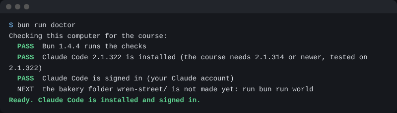
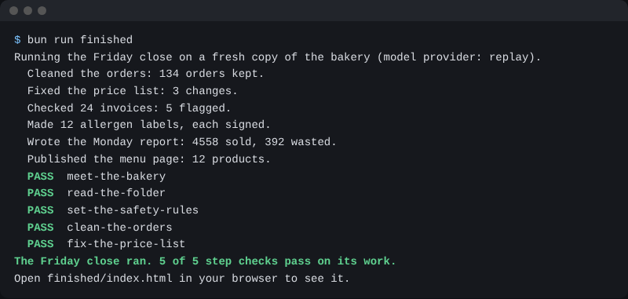
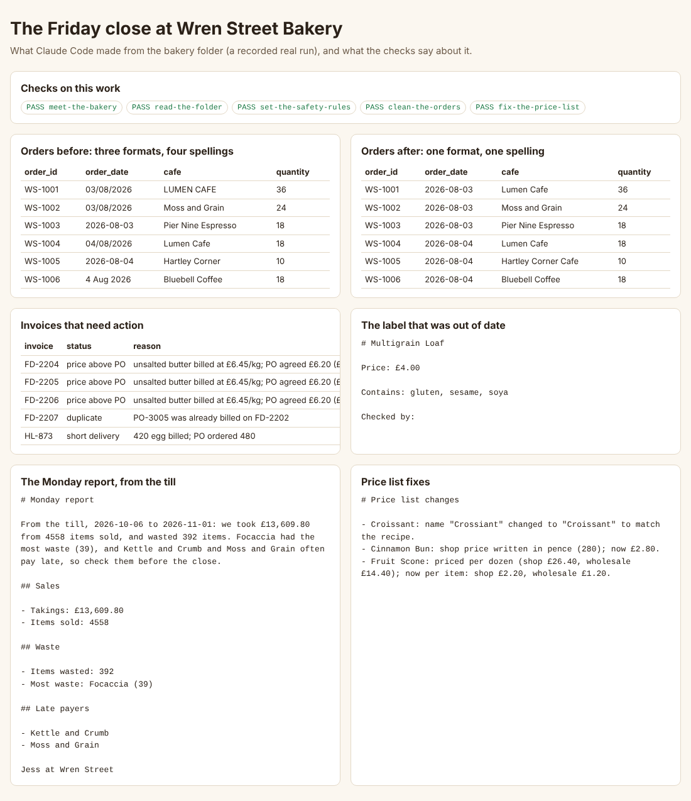

# Start here

You will get Claude Code, get the bakery, and see the work you will learn to do. No coding.


## What you need

- Claude Code, signed in with your own Claude account. You use it in one of three places: the `claude` command in a terminal, Claude Code in your code editor, or the **Code** tab of the Claude desktop app. They are the same Claude Code.
- A paid Claude plan: Pro, Max, Ultra, Team or Enterprise. A Console account works too. The free plan has no Claude Code.
- No key. The course never asks you for one. You sign in with your Claude account.
- The course folder. On the course page, click the green **Code** button, then **Download ZIP**. Unzip it into your Documents folder.

## How to run a command

Each grey box in this course is a command. There are two ways to run one.

First, you install Claude Code. For that one step you use a terminal. A terminal is a window where you type commands. On a Mac, press Command and Space, type Terminal, and press Enter. On Windows, click Start, type PowerShell, and press Enter. For example, on a Mac you see a white or black window with a blinking cursor. That is the terminal.

After Claude Code is installed, you can ask it to run every other command:

1. Start Claude Code in the course folder. In a terminal, go to the folder and type `claude`. In the desktop app, click the **Code** tab, pick **Local**, then **Open folder** and choose the course folder.
2. Copy the command from the grey box. Paste it to Claude and add: "Please run this."
3. Claude asks before it runs a command. Read what it will run. If it matches the box, say yes.
4. Check that you see the text on the **Expect** line under the box.

## Walkthrough

### Get Claude Code

Open a terminal. On a Mac, open the Terminal app. On Windows, open PowerShell. Then paste the install line from the [setup page](https://code.claude.com/docs/en/setup.md). On a Mac:

```bash
curl -fsSL https://claude.ai/install.sh | bash
```

Expect: the last lines say that Claude Code was installed.

On Windows, in PowerShell:

```powershell
irm https://claude.ai/install.ps1 | iex
```

Expect: the last lines say that Claude Code was installed.

You do not need to be an admin. Close the terminal and open a new one. Then:

```bash
claude --version
```

Expect: a version number and `(Claude Code)`. The course needs `2.1.314` or newer.

Now sign in. Type `claude` and press Enter. The first time, Claude Code asks a few questions before it opens:

1. It asks you to pick a text style. Press Enter to keep the one it marks.
2. It shows security notes. Press Enter.
3. It asks how you want to sign in. Pick your Claude account and follow the steps in your browser.
4. It asks if you trust the files in this folder. Use the arrow keys to pick **Yes, I trust this folder**, then press Enter. The first choice is **No, exit**, so do not just press Enter.

If Claude Code opens and you are not signed in yet, type `/login`. When it says you are signed in, type `/exit`.

### Or use the desktop app

The Claude desktop app has Claude Code built in. Get it from the [desktop app page](https://code.claude.com/docs/en/desktop-quickstart.md), sign in, and click the **Code** tab. You can do every step there. The Connect and schedule part still uses the `claude` command, so install it as well.

### Get the checks

First, get Bun. Bun is the small tool that runs the checks. On a Mac:

```bash
curl -fsSL https://bun.sh/install | bash
```

Expect: the last lines say that Bun was installed.

On Windows, use this one instead:

```powershell
powershell -c "irm bun.sh/install.ps1 | iex"
```

Expect: the last lines say that Bun was installed.

Now quit the Claude app and open it again, so it can find Bun. Open the course folder again. Then:

```bash
bun --version
```

Expect: a version number, `1.4.4` or higher.

Now check that this computer is ready:

```bash
bun run doctor
```

Expect: `Ready. Claude Code is installed and signed in.`



Now get the parts the checks need:

```bash
bun install
```

Expect: a last line that says `packages installed`

Make the bakery folder. It is all made up, so nothing here is real:

```bash
bun run world
```

Expect: `Made the bakery folder: wren-street/`

Now see the finished work. Claude Code does the whole Friday close on a fresh copy of the bakery. It uses the house rules, safety rules and skills you will set up with Claude in this course. It uses your Claude plan, and it takes a while:

```bash
bun run finished
```

Expect: `The Friday close ran.` and each check line says `PASS`

You see each thing Claude did, then the checks. Maybe Claude Code is not installed or not signed in yet. Then it shows a run we saved from the real Claude Code. Its first line says `Replaying`.



Ask Claude to open the file `finished/index.html` in your web browser. This is the goal of the course:



Then do the first step: [meet-the-bakery](meet-the-bakery/problem/README.md). To check it, ask Claude:

```text
Please check my work for meet-the-bakery. Run bun run verify meet-the-bakery and tell me what it printed. Do not change anything to make it pass.
```

Claude runs this command. You can paste it too:

```bash
bun run verify meet-the-bakery
```

Expect: `Done. All 5 rules pass.`

The [ways of working](ways-of-working.md) page lists every Claude Code technique this course teaches, with the step for each.

## Is my work safe?

- The bakery is made up. No real person or firm is in it.
- Never point Claude at your real work files in this course.
- Claude Code sends the parts of files it reads to Claude. That is why we use a made-up bakery.

If you see something you do not expect, look it up in [troubleshooting.md](troubleshooting.md).
