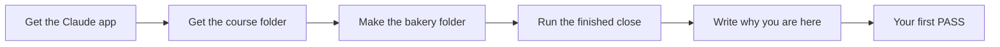

# Start here

You will get the app, get the bakery, and see the work you will learn to do. No coding.



## What you need

- The Claude desktop app, for Mac or Windows. The download links are on the [desktop app page](https://code.claude.com/docs/en/desktop-quickstart.md).
- A paid Claude plan: Pro, Max, Ultra, Team or Enterprise. The free plan has no Code tab.
- The course folder. On the course page, click the green **Code** button, then **Download ZIP**. Unzip it into your Documents folder.

## How to run a command

Each grey box in this course is a command. You do not need to type it.

1. Open the Claude app and click the **Code** tab at the top of the side bar.
2. Under the box where you type, click the first button. Pick the top entry under **Local**.
3. Click the folder button next to it. Pick **Open folder** and choose the course folder.
4. Copy the command from the grey box. Paste it to Claude and add: "Please run this."
5. Claude asks before it runs a command. Read what it will run. If it matches the box, say yes.
6. Check that you see the text on the **Expect** line under the box.

If you like, you can paste the commands into the app's terminal instead. Press Ctrl and the back tick key to open it. They work the same way.

## Walkthrough

First, get Bun. Bun is the small tool that runs the checks. On a Mac:

```bash
curl -fsSL https://bun.sh/install | bash
```

Expect: the last lines say that Bun was installed.

On Windows, use this one instead:

```powershell
powershell -c "irm bun.sh/install.ps1 | iex"
```

Expect: the last lines say that Bun was installed.

Now quit the Claude app and open it again, so it can find Bun. Open the course folder again. Then:

```bash
bun --version
```

Expect: a version number, `1.4.4` or higher.

Now get the parts the checks need:

```bash
bun install
```

Expect: a last line that says `packages installed`

Make the bakery folder. It is all made up, so nothing here is real:

```bash
bun run world
```

Expect: `Made the bakery folder: wren-street/`

Now see the finished work. This does the whole Friday close on a fresh copy of the bakery:

```bash
bun run finished
```

Expect: `The Friday close ran.` and each check line says `PASS`


Ask Claude to open the file `finished/index.html` in your web browser. This is the goal of the course:


Then do the first step: [meet-the-bakery](meet-the-bakery/problem/README.md). Its check is:

```bash
bun run verify meet-the-bakery
```

Expect: `Done. All 5 rules pass.`

## Is my work safe?

- The bakery is made up. No real person or firm is in it.
- Never point Claude at your real work files in this course.
- The app may send copies of files to Claude to read them. That is why we use a made-up bakery.

If you see something you do not expect, look it up in [troubleshooting.md](troubleshooting.md).
