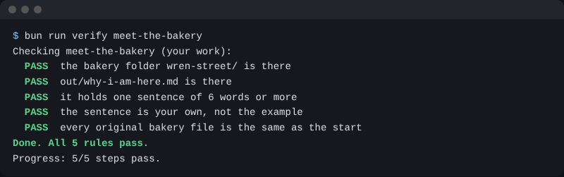

# Meet the bakery

## The problem

Jess owns Wren Street Bakery. She has one shop and sells bread to six cafes.

Each Friday close takes her most of the morning. She fixes the order sheet line by line. She checks each bill. She writes the labels and the report.

You will learn to hand this work to Claude, and to check what it made. But first, you need to know your own reason to be here.

## Your challenge

Think of one task at your own job that you do by hand, again and again. Ask Claude to save it as one sentence.

Paste this to Claude, but change the part in brackets:

```text
Make the file wren-street/out/why-i-am-here.md. Put this one sentence in it:
I want Claude to [the task you do by hand at work].
```

Claude will ask before it makes the file. Read what it will write. Then say yes.

Do not use the example on this page. Use your own task. You will come back to this sentence at the end of the course.

## Done when

- The file `wren-street/out/why-i-am-here.md` is there.
- It holds one sentence of 6 words or more.
- The sentence is your own, not the example.
- No file in the bakery has changed.

```bash
bun run verify meet-the-bakery
```

Expect: `Done. All 5 rules pass.`



## If you get stuck

| What you see                                               | Try this                                           |
| ---------------------------------------------------------- | -------------------------------------------------- |
| `FAIL the bakery folder wren-street/ is there`             | Run `bun run world` first.                         |
| `FAIL it holds one sentence of 6 words or more`            | Write one full sentence. End it with a full stop.  |
| `FAIL the sentence is your own, not the example`           | Name a task from your own job.                     |
| `FAIL every original bakery file is the same as the start` | Run `bun run world status`. It shows what changed. |

## Words you will use

- **Folder**: a place on your computer that holds files.
- **Check**: a small program that reads your files and says PASS or FAIL.
- **Original**: a file that came with the bakery. You never change it.
