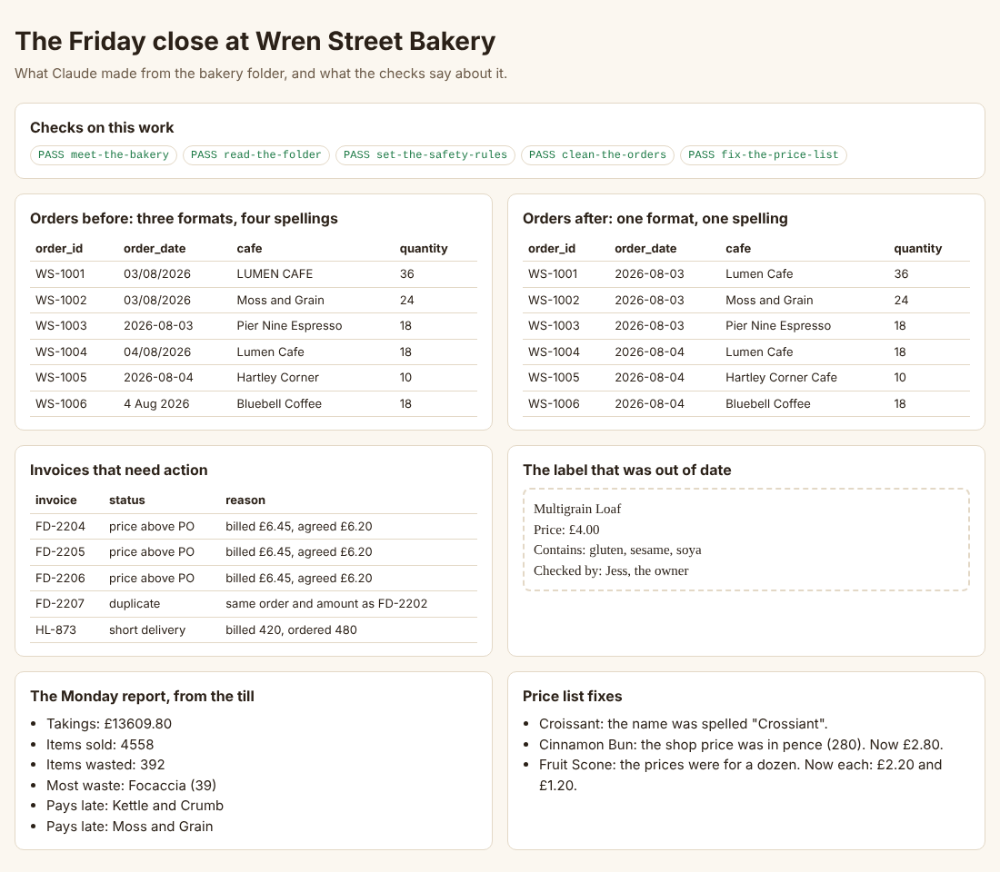
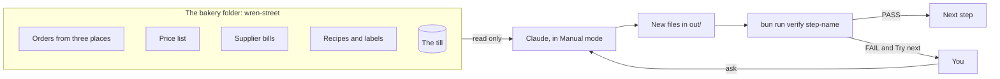

# Claude Code for Everyone

Hand your real file work to Claude, and catch its mistakes before anyone else does. No coding.

This course is for people who run part of a business in sheets, PDFs and email: ops, finance, HR, admin and founders. You have never opened a terminal? That is fine.

After this course you can give Claude a folder of business files, tell it the rules, check what it made with a script, and undo anything. You leave with a project that proves it.

## See the finished work first

You work in a made-up bakery, Wren Street Bakery. Here is the whole Friday close, done for you. It needs no key and no account.

```bash
bun install
```

Expect: a last line that says `packages installed`

```bash
bun run world
```

Expect: `Made the bakery folder: wren-street/`

```bash
bun run finished
```

Expect: `The Friday close ran.` and each check line says `PASS`

Open `finished/index.html` in your browser. You should see this:



New to all of this? Start with [00-orientation](00-orientation/README.md). It shows you how to run each command by asking Claude.

## What you work on



Jess owns the bakery. Her files are a mess, on purpose. Every mistake in them was put there by the course, so the checks know the right answer.

Claude never changes Jess's original files. It makes new files in `out/`. A check reads those files, not the chat, and says PASS or FAIL.

## The parts

| Part | What you learn | Steps | Minutes |
|---|---|---|---|
| [Orientation](00-orientation/README.md) | Get set up, meet the bakery, see the goal | meet-the-bakery | 20 |
| [Make Claude ask before it acts](parts/01-make-claude-ask-first/README.md) | Manual mode, safe settings, clean a sheet, fix a price list | read-the-folder, set-the-safety-rules, clean-the-orders, fix-the-price-list | 65 |
| [Teach Claude the bakery](parts/02-teach-the-bakery/README.md) | House rules, a plan first, check bills against orders | write-the-house-rules, plan-the-invoice-check, reconcile-the-invoices | 60 |
| [Undo anything](parts/03-undo-anything/README.md) | Save points, rewind, and what rewind cannot undo | make-a-save-point, rewind-a-bad-edit, recover-a-deleted-file | 35 |
| [Do it the same way every time](parts/04-repeat-the-work/README.md) | Write what done means first, then a skill, then sign off | write-the-done-list, build-the-label-skill, sign-off-the-labels | 45 |
| [Connect it and let it run](parts/05-connect-and-schedule/README.md) | The terminal, a connector, a report that runs by itself | open-the-terminal, connect-the-till, write-the-monday-report, schedule-the-monday-report | 75 |
| [Share it](parts/06-share-the-close/README.md) | A web page, a kit for the next hire, the whole close on new data | publish-the-menu-page, pack-the-bakery-kit, run-the-friday-close, map-your-own-close | 85 |

Each step has one check. Run it with the step name:

```bash
bun run verify clean-the-orders
```

Expect: a PASS or FAIL line for each rule, and a `Try next:` line under each FAIL.

## The project

The Friday close. At the end, the check drops in a batch of orders and bills you have never seen. You run your close once. Every check must pass again.

You also map the close onto one task from your own job: its files, its first house rule, and one check a script could run.

## What you need

- The Claude desktop app, for Mac or Windows.
- A paid Claude plan: Pro, Max, Ultra, Team or Enterprise. The free plan has no Code tab.
- No key for any model. The checks and the finished close run without one.

## Read before you start

| Read | By | Why |
|---|---|---|
| [How people are using Claude Cowork](https://claude.com/blog/how-people-are-using-claude-cowork) | Anthropic | Most of this use is office work, not code. |
| [Use Claude Cowork safely](https://support.claude.com/en/articles/13364135-use-claude-cowork-safely) | Anthropic | The risks this course handles, one by one. |
| [How AI agents shape experts' judgment calls](https://www.anthropic.com/research/agents-judgment-calls) | Anthropic | Why you write what done means before Claude answers. |

## For people who run the course

- `bun run check` proves the repo meets [STANDARD.md](STANDARD.md).
- `bun test` checks reading level and the help table.
- `bun run world reset` puts the bakery back. The old folder is kept.
- `bun run models` tests a live model, if you set one in `.env`. See `.env.example`.
- [PARTS.md](PARTS.md) lists every part, step and check.
