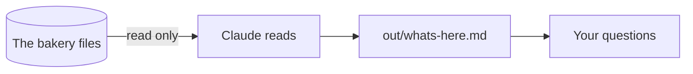
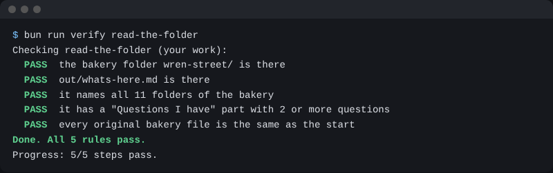

# Read the folder

## The problem

You have a new folder full of files. You do not know what is in it yet. Neither does Claude.

If you ask Claude to fix things now, it will guess. A guess can change the wrong file. So the first job is to read, and change nothing.



## Your challenge

Open the `wren-street` folder in the Code tab. Under the box where you type, find the mode button. Pick **Plan**. In Plan mode, Claude can look but it cannot change files.

Paste this to Claude:

```text
Look at every folder in this bakery folder. Do not change any file.
Tell me what each folder holds, in one short line each.
Then tell me two things you are not sure about.
```

Read the answer. Does it match what you see in the folder?

Now pick **Manual** in the mode button. Paste this:

```text
Save what you just told me as out/whats-here.md.
Put one line for each folder. Then add a heading "## Questions I have"
with your two questions under it, each on a line that starts with a dash.
```

Claude will ask before it makes the file. Read it, then say yes.

## Done when

- `out/whats-here.md` is there.
- It names all 11 folders, from `orders` to `notes`.
- It has a "Questions I have" part with 2 or more questions.
- No original file has changed.

```bash
bun run verify read-the-folder
```

Expect: `Done. All 5 rules pass.`



## If you get stuck

| What you see | Try this |
|---|---|
| `FAIL it names all 11 folders of the bakery` | Ask Claude to add one line for each folder it left out. |
| `FAIL it has a "Questions I have" part` | The heading must say Questions I have. Each question starts with a dash. |
| `FAIL every original bakery file is the same as the start` | Run `bun run world status` to see what changed. |

## Words you will use

- **Plan mode**: Claude can read and think, but it cannot change a file.
- **Manual mode**: Claude asks you before it changes a file or runs a command.
- **out/**: the one folder where new files go.
