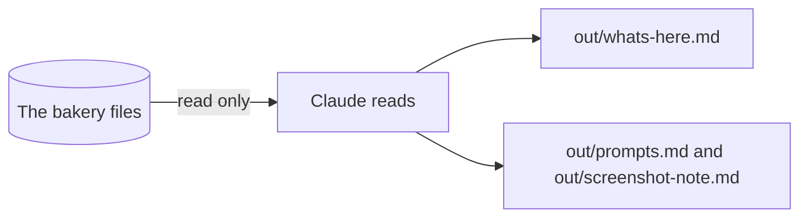

# Read the folder

## The problem

A new folder full of files is a puzzle. If Claude guesses what is in it, it can change the wrong file. Anthropic found that people say yes to 93% of the prompts Claude shows them ([Anthropic, auto mode](https://www.anthropic.com/research/claude-code-auto-mode)). So the first job is to read, and change nothing.



## Watch it done

Before, the folder has no notes. After, `out/` holds three small files you saved. This is the real output of the check on the finished work:

```text
  PASS  out/whats-here.md is there
  PASS  it names all 11 folders of the bakery
  PASS  out/prompts.md is a saved prompt that points at a real file with @
  PASS  out/screenshot-note.md has a "Screenshot of:" line and a "What Claude said" part
```

## Your turn

The example uses two files: `orders/wholesale-orders.csv` and `menu/menu.md`.

1. Open `wren-street` in the Code tab. Pick **Plan** in the mode button. Plan mode lets Claude look, but not change files.
2. Paste: `Look at every folder. Do not change any file. Say what each holds in one line, then two things you are not sure about.`

   Expect: eleven short lines, then two questions.
3. Pick **Manual**, then ask Claude to save it as `out/whats-here.md`, with a "## Questions I have" heading and dashes. Claude asks first. Say yes.

   Expect: a new file in `out/`.
4. Point at one file with the at sign. Type `@orders/wholesale-orders.csv` and ask what is wrong with the dates. The @ tells Claude exactly which file to open.

   Expect: Claude names the file and lists the date styles.
5. Ask Claude to save that prompt as `out/prompts.md`.

   Expect: a file with your `@` line in it.
6. Take a screenshot of the sheet or of `menu/menu.md` open on your screen. Drag it into the chat and ask what it shows.

   Expect: a plain description of the picture.
7. Save it as `out/screenshot-note.md`. Start with `Screenshot of:` and what you shot. Then add "## What Claude said" and its answer.

## Do it on your work

Do steps 4 to 7 on one file of your own, such as a bill or a list. Use a picture of something in the world too, such as a shelf or a receipt. Good looks like: Claude names the right file, and the note says what the picture showed in your own words.

## Done when

- `out/whats-here.md` names all 11 folders and has two questions.
- `out/prompts.md` has an `@` line that points at a real file.
- `out/screenshot-note.md` has the "Screenshot of:" line and Claude's answer.
- No original file has changed.

To check, ask Claude: "Please check my work for read-the-folder. Run it and tell me what it printed. Do not change anything to make it pass."

```bash
bun run verify read-the-folder
```

Expect: `Done. All 7 rules pass.`


## Solution

The finished files are in `solution/out/`: `whats-here.md`, `prompts.md` and `screenshot-note.md`.

## Go further

- Ask Claude to read two folders together with two `@` mentions.
- Screenshot a label on the shelf and ask if it matches its recipe.

## If you get stuck

| What you see                                                   | Try this                                                    |
| -------------------------------------------------------------- | ----------------------------------------------------------- |
| `FAIL it names all 11 folders of the bakery`                   | Ask Claude to add a line for each folder it left out.       |
| `FAIL out/prompts.md is a saved prompt`                        | Write the path after the @ with no space, and check it.     |
| `FAIL out/screenshot-note.md has a "Screenshot of:" line`      | Add the first line and the "What Claude said" heading.      |
| `FAIL every original bakery file is the same as the start`     | Run `bun run world status` to see what changed.             |

## Words you will use

- **Plan mode**: Claude can read and think, but it cannot change a file.
- **Manual mode**: Claude asks you before it changes a file or runs a command.
- **@ mention**: typing @ and a path to point Claude at one file.
