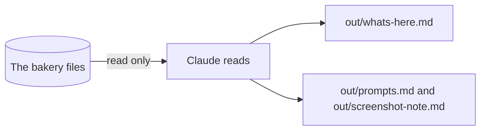

# Read the folder

## The problem

A new folder full of files is a puzzle. If Claude guesses what is in it, it can change the wrong file. Anthropic found that people say yes to 93% of the prompts Claude shows them ([Anthropic, auto mode](https://www.anthropic.com/research/claude-code-auto-mode)). So the first job is to read, and change nothing.



## Watch it done

Before, `out/` is empty. After, it holds three notes. This is the check on the finished work:

```text
  PASS  it names all 11 folders of the bakery
  PASS  out/prompts.md is a saved prompt that points at a real file with @
  PASS  out/screenshot-note.md has a "Screenshot of:" line and a "What Claude said" part
```

## Your turn

Files: `orders/wholesale-orders.csv` and `menu/menu.md`.

1. Open `wren-street` in the Code tab. Pick **Plan**. Claude can look but not change files.
2. Paste: `Look at every folder. Change nothing. Say what each holds in one line, then two things you are unsure about.`

   Expect: eleven short lines, then two questions.
3. Pick **Manual**. Ask Claude to save it as `out/whats-here.md`, with a "## Questions I have" heading and dashes. Say yes.

   Expect: a new file in `out/`.
4. Type `@orders/wholesale-orders.csv` and ask what is wrong with the dates. The @ points Claude at one file. For example, it names the file and lists the date styles.

   Expect: an answer about that file only.
5. Ask Claude to save that prompt as `out/prompts.md`.

   Expect: a file with your `@` line in it.
6. Screenshot the sheet or `menu/menu.md` on your screen. Drag it into the chat and ask what it shows.

   Expect: a plain description of the picture.
7. Save it as `out/screenshot-note.md`: a line `Screenshot of:` and what you shot, then "## What Claude said" and its answer.

## Do it on your work

Do steps 4 to 7 on one file of your own, and on a picture of a shelf or a receipt. Good looks like: Claude names the right file, and the note says what the picture showed.

## Done when

- `out/whats-here.md` names all 11 folders and has two questions.
- `out/prompts.md` has an `@` line that points at a real file.
- `out/screenshot-note.md` has the "Screenshot of:" line and Claude's answer.
- No original file has changed.

To check, ask Claude: "Run the check for read-the-folder and tell me what it printed. Change nothing."

```bash
bun run verify read-the-folder
```

Expect: `Done. All 7 rules pass.`


## Solution

The finished files are in `solution/out/`: `whats-here.md`, `prompts.md` and `screenshot-note.md`.

## If you get stuck

| What you see                                                   | Try this                                                    |
| -------------------------------------------------------------- | ----------------------------------------------------------- |
| `FAIL it names all 11 folders of the bakery`                   | Ask Claude to add a line for each folder it left out.       |
| `FAIL out/prompts.md is a saved prompt`                        | Write the path right after the @, with no space.            |
| `FAIL out/screenshot-note.md has a "Screenshot of:" line`      | Add the first line and the "What Claude said" heading.      |
| `FAIL every original bakery file is the same as the start`     | Run `bun run world status` to see what changed.             |

## Words you will use

- **Plan mode**: Claude can read, not change.
- **Manual mode**: Claude asks before it changes a file.
- **@ mention**: an @ and a path, to point at one file.
