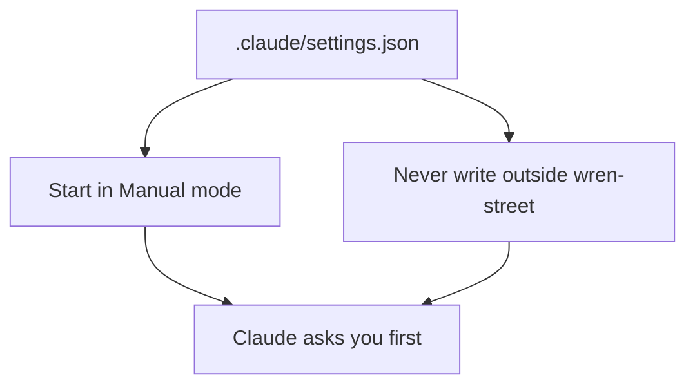

# Set the safety rules

## The problem

The mode button resets when you start a new chat. Some plans start in Auto mode. In Auto mode, Claude does not ask you first.

You want the safe choice to be the one you get without trying. So you write it down in a settings file. Claude reads it each time it opens this folder.



## Your challenge

Keep the mode on **Manual**. Paste this to Claude:

```text
Make the file .claude/settings.json in this folder with this in it:
{
  "permissions": {
    "defaultMode": "default",
    "blockWritesOutsideWorkingDirectories": true
  }
}
```

The word `default` is the name the file uses for Manual mode.

Then write a short note for yourself. Paste this:

```text
Make out/safety.md. Say that I work in Manual mode. Add a heading
"## Claude will ask me before" and list two things, each on a line
that starts with a dash.
```

Now start a new chat in the same folder. Look at the mode button. It should say **Manual**.

## Done when

- `.claude/settings.json` is there and is valid.
- It starts Claude in Manual mode.
- It stops Claude from writing outside the bakery folder.
- `out/safety.md` names Manual mode and lists 2 things Claude will ask about.
- No original file has changed.

```bash
bun run verify set-the-safety-rules
```

Expect: `Done. All 7 rules pass.`


## If you get stuck

| What you see                                         | Try this                                                      |
| ---------------------------------------------------- | ------------------------------------------------------------- |
| `FAIL .claude/settings.json is there and is valid`   | Look for a comma after the last line in a block. Take it out. |
| `FAIL Claude starts in Manual mode`                  | The value must be `default`, not `auto` or `manual`.          |
| `FAIL Claude cannot write outside the bakery folder` | Add the second line, with the value `true`.                   |
| `FAIL out/safety.md lists 2 things`                  | Check the heading words and the dashes.                       |

## Words you will use

- **Settings file**: a file that tells Claude how to behave in this folder.
- **Auto mode**: Claude decides what is safe and does not ask you.
- **Valid**: written the right way, so the app can read it.
