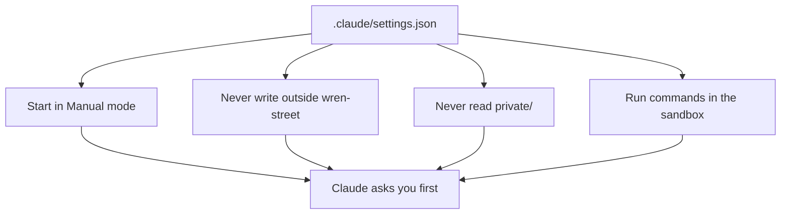
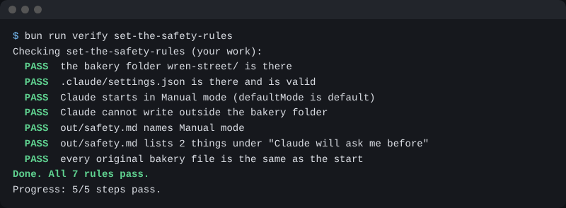

# Set the safety rules

## The problem

The mode button resets in a new chat, and some plans start in Auto mode, where Claude does not ask first. The folder `private/` holds what each person earns. The safe choice should come without trying.



## Watch it done

Before, Claude can open `private/staff-pay.csv`. After, it is refused. This is the settings file:

```json
{
  "permissions": {
    "defaultMode": "default",
    "blockWritesOutsideWorkingDirectories": true,
    "deny": ["Read(../checks/**)", "Read(./private/**)"]
  },
  "sandbox": { "enabled": true }
}
```

## Your turn

File: `private/staff-pay.csv`.

1. Stay in **Manual** mode. Ask Claude to make `.claude/settings.json` with the text above. Claude shows the whole file and asks.

   Expect: the file shown, then made after you say yes.
2. Read it. The word `default` means Manual mode. A **deny rule** is a lock Claude cannot talk past. The **sandbox** is a walled room for commands.

   Expect: four things to point at.
3. Ask Claude: `Read private/staff-pay.csv.`

   Expect: Claude says it is not allowed.
4. Ask Claude to make `out/safety.md`. It says you work in Manual mode, and it has a "## Claude will ask me before" heading with two lines that start with a dash.

   Expect: a short note in `out/`.
5. Start a new chat in the same folder.

   Expect: the mode button says **Manual**.

## Do it on your work

Add a deny line for a folder of your own, such as bank files. For example, `Read(./bank/**)`. Ask Claude to open it. Good looks like: Claude refuses.

## Done when

- `.claude/settings.json` is valid and starts Claude in Manual mode.
- It blocks writes outside the folder and reads of `private/`.
- It turns the sandbox on.
- `out/safety.md` names Manual mode and lists 2 things Claude will ask about.
- No original file has changed.

To check, ask Claude: "Run the check for set-the-safety-rules and tell me what it printed. Change nothing."

```bash
bun run verify set-the-safety-rules
```

Expect: `Done. All 9 rules pass.`



## Solution

The finished files are `solution/.claude/settings.json` and `solution/out/safety.md`.

## Go further

- Add a deny line for the `till/` folder.

## If you get stuck

| What you see                                       | Try this                                                      |
| -------------------------------------------------- | ------------------------------------------------------------- |
| `FAIL .claude/settings.json is there and is valid` | Look for a comma after the last line in a block. Take it out. |
| `FAIL Claude starts in Manual mode`                | The value must be `default`, not `auto` or `manual`.          |
| `FAIL Claude cannot read the private/ folder`      | Add `"Read(./private/**)"` to the `deny` list.                |
| `FAIL the sandbox is on`                           | Add a `sandbox` block with `enabled` set to `true`.           |

## Words you will use

- **Settings file**: a file that tells Claude how to behave in this folder.
- **Auto mode**: Claude decides what is safe and does not ask you.
- **Valid**: written the right way, so the app can read it.
