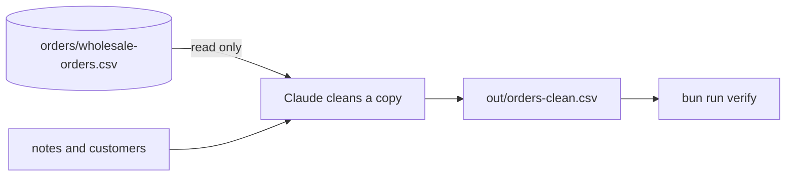

# Clean the orders

## The problem

Cafe orders come to Jess in three ways: the web shop, the phone and email. She puts them in one sheet. Now the sheet is a mess.

The dates are written three ways. One cafe is spelled four ways. Some rows are in twice. Some numbers are words, like "two dozen". Jess cannot add it up.

This is common work. Anthropic looked at 1.2 million sessions in Cowork, a part of the Claude app. A third of them (33.4%) were business and operations jobs like this one ([Anthropic](https://claude.com/blog/how-people-are-using-claude-cowork)).



## Your challenge

Stay in Manual mode. Paste this to Claude:

```text
Read orders/wholesale-orders.csv. Do not change it.
Make a clean copy at out/orders-clean.csv with the columns
order_id, order_date, cafe, product, quantity.
Before you start, tell me every problem you see in the file.
```

For example, the phone order `WS-1001` says `03/08/2026` and `LUMEN CAFE`. The date means the 3rd of August. In the clean copy, the date starts with the year, and the cafe is `Lumen Cafe`.

Read the list of problems. Did Claude find all four kinds? If not, tell it what it missed.

Then run the check. Each FAIL line says what is still wrong. Tell Claude, and run it again.

Hint: Jess wrote some rules in `notes/owner-notes.md`. The right cafe names are in `customers/cafes.csv`.

## Done when

- `out/orders-clean.csv` is there, with the five columns.
- Every date is written YYYY-MM-DD, and it is the right date.
- Each cafe has one spelling, from `customers/cafes.csv`.
- No order is in the file twice, and no real order was lost.
- Every quantity is a whole number.
- The original orders file has not changed.

```bash
bun run verify clean-the-orders
```

Expect: `Done. All 10 rules pass.`


## If you get stuck

| What you see                                             | Try this                                                            |
| -------------------------------------------------------- | ------------------------------------------------------------------- |
| `FAIL every date is the right date`                      | Phone orders put the day first. Ask Claude to read the notes again. |
| `FAIL no real order was lost`                            | Only drop a row when every cell is the same as another row.         |
| `FAIL every quantity is a whole number`                  | Ask Claude to turn words into numbers. A dozen is 12.               |
| `FAIL the original orders file is the same as the start` | Run `bun run world reset`. Your old folder is kept.                 |

## Words you will use

- **CSV**: a plain sheet file. Each line is a row. Commas split the cells.
- **Copy**: a row that is the same as another row in every cell.
- **YYYY-MM-DD**: year, month, day, with dashes between.
