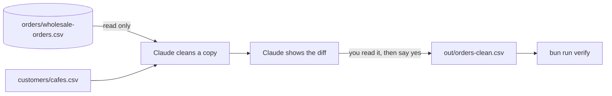
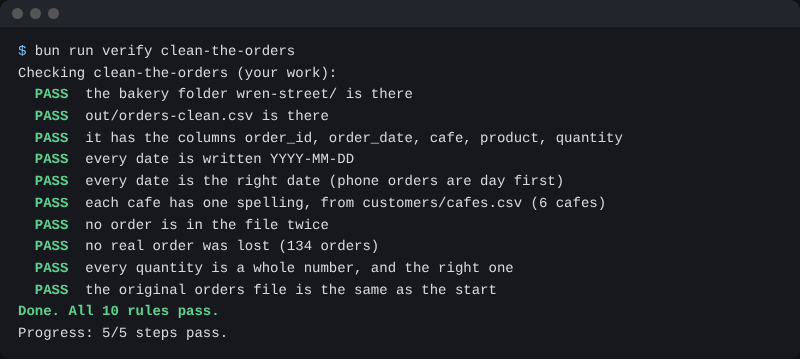

# Clean the orders

## The problem

Jess puts web, phone and email orders in one sheet. Dates are written three ways, one cafe four ways, and some rows are in twice. A third (33.4%) of 1.2 million Cowork sessions were business jobs like this ([Anthropic](https://claude.com/blog/how-people-are-using-claude-cowork)).



## Watch it done

Before, the original has the first row. After, the clean copy has the second:

```text
WS-1001,03/08/2026,LUMEN CAFE,Sourdough Loaf,36,phone
WS-1001,2026-08-03,Lumen Cafe,Sourdough Loaf,36
```

A **diff** shows what changed between two files. Read it to catch a wrong change before you say yes.

## Your turn

Files: `orders/wholesale-orders.csv` and `customers/cafes.csv`.

1. In Manual mode, paste: `Read orders/wholesale-orders.csv. Change nothing. List every problem, then make a clean copy at out/orders-clean.csv with the columns order_id, order_date, cafe, product, quantity. Use the cafe names in customers/cafes.csv.`

   Expect: a list of problems first: dates, cafe names, copies, number words.
2. When Claude asks to make the file, read what it shows before you say yes. For example, is 03/08/2026 the 3rd of August? Phone orders put the day first.

   Expect: green lines for the new file.
3. Ask: `Run diff on the original and the clean copy. Show the first changed lines.`

   Expect: the old row and the new row, like above.
4. Pick one changed line. Ask Claude to save `out/diff-note.md`: a dash line with the order id and what it became, then "## Why it is right" and one sentence.

   Expect: a short note in `out/`.
5. Run the check.

   Expect: each FAIL line says what is still wrong. Tell Claude and run it again.

## Do it on your work

Do the same on a copy of one sheet of your own. Read the diff, pick one changed line, and write why it is right. Good looks like: you say why in your own words.

## Done when

- `out/orders-clean.csv` has the five columns, one date style, one spelling per cafe, no repeated order and no lost order.
- Every quantity is a whole number.
- `out/diff-note.md` names a changed order and says why the change is right.
- The original orders file has not changed.

To check, ask Claude: "Run the check for clean-the-orders and tell me what it printed. Change nothing."

```bash
bun run verify clean-the-orders
```

Expect: `Done. All 12 rules pass.`



## Solution

The finished files are `solution/out/orders-clean.csv` and `solution/out/diff-note.md`.

## If you get stuck

| What you see                                             | Try this                                                            |
| -------------------------------------------------------- | ------------------------------------------------------------------- |
| `FAIL every date is the right date`                      | Phone orders put the day first. Ask Claude to read the notes again. |
| `FAIL no real order was lost`                            | Only drop a row when every cell is the same as another row.         |
| `FAIL out/diff-note.md names a changed order`            | Use an order id such as WS-1001 and its new value, on one line.     |
| `FAIL the original orders file is the same as the start` | Run `bun run world reset`. Your old folder is kept.                 |

## Words you will use

- **CSV**: a plain sheet file. Commas split the cells.
- **Copy**: a row the same as another in every cell.
- **YYYY-MM-DD**: year, month, day, with dashes.
