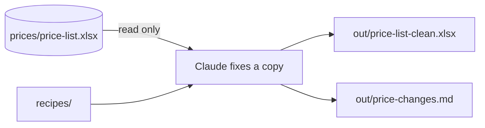
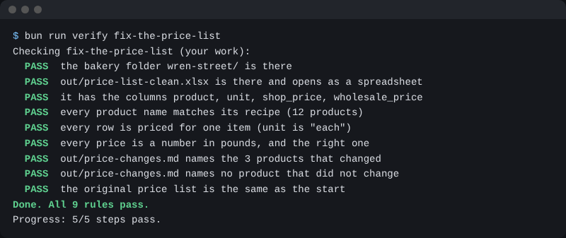

# Fix the price list

## The problem

The price list is a spreadsheet. It has three mistakes. One name is spelled wrong. One price is in pence, not pounds. One row is priced for a dozen, when every other row is priced for one.

A wrong price on a list goes on to the menu, the labels and the bills. And a fix you cannot see is a fix nobody can check. So Claude must also write down each change.



## Your challenge

Stay in Manual mode. Paste this to Claude:

```text
Read prices/price-list.xlsx. Do not change it. Compare each product
name with the first line of its recipe in recipes/.
Find what is wrong in the list, and tell me before you fix anything.
```

When you agree with the list of mistakes, paste this:

```text
Save the fixed list as out/price-list-clean.xlsx, with the same columns.
Prices must be numbers in pounds, for one item. Then write
out/price-changes.md with one line for each product you changed.
```

For example, the list says the Cinnamon Bun costs 280. That is 280 pence. The clean list says 2.8, which is £2.80.

Do not let Claude change a price that was already right. The menu on the wall is not the price list.

## Done when

- `out/price-list-clean.xlsx` opens, with the same four columns.
- Every product name matches its recipe.
- Every row is priced for one item.
- Every price is a number in pounds, and the right one.
- `out/price-changes.md` names the 3 products that changed, and no others.
- The original price list has not changed.

```bash
bun run verify fix-the-price-list
```

Expect: `Done. All 9 rules pass.`



## If you get stuck

| What you see                                | Try this                                                                   |
| ------------------------------------------- | -------------------------------------------------------------------------- |
| `FAIL every price is a number in pounds`    | Look for 280. That is pence. Also check that prices are not saved as text. |
| `FAIL every row is priced for one item`     | Find the row that says dozen. Divide its prices by 12.                     |
| `FAIL names no product that did not change` | Take out any line about a product that was already right.                  |

## Words you will use

- **Spreadsheet**: a file of rows and columns, like Excel or Numbers.
- **Pence**: there are 100 pence in one pound.
- **Change list**: a short note of each change, so a person can check it.
