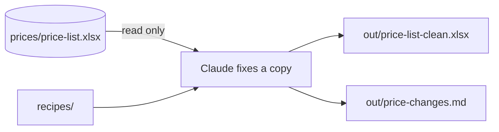

# Fix the price list

## The problem

The price list has three mistakes. One name is spelled wrong, one price is in pence, and one row is priced for a dozen. A wrong price flows on to the menu, the labels and the bills. A fix nobody can see is a fix nobody can check, so Claude must write each change down.



## Watch it done

For example, before, the list says the Cinnamon Bun costs 280. That is pence. After, it says 2.8, which is £2.80. This is the real change list:

```text
- Croissant: name spelled Crossiant, now Croissant
- Cinnamon Bun: shop price 280 pence, now 2.8 pounds
- Fruit Scone: priced for a dozen, now priced for one
```

## Your turn

The example uses two files: `prices/price-list.xlsx` and `recipes/croissant.md`.

1. Stay in Manual mode. Paste: `Read prices/price-list.xlsx. Do not change it. Compare each product name with the first line of its recipe in recipes/. Tell me what is wrong before you fix anything.`

   Expect: a list of three mistakes.
2. Agree with the list. Paste: `Save the fixed list as out/price-list-clean.xlsx, with the same columns. Prices are numbers in pounds, for one item.`

   Expect: Claude asks, shows the file, and makes it after you say yes.
3. Ask: `Write out/price-changes.md with one line for each product you changed.`

   Expect: three lines, no more.
4. Do not let Claude change a price that was already right. The menu on the wall is not the price list.

   Expect: Sourdough Loaf is not in the change list.

## Do it on your work

Do the same on one list of your own, such as stock or fees. Work on a copy. Good looks like: every change is on the list, and nothing else moved.

## Done when

- `out/price-list-clean.xlsx` opens, with the same four columns.
- Every name matches its recipe, every row is for one item, and every price is a number in pounds.
- `out/price-changes.md` names the 3 products that changed, and no others.
- The original price list has not changed.

To check, ask Claude: "Run the check for fix-the-price-list and tell me what it printed. Change nothing."

```bash
bun run verify fix-the-price-list
```

Expect: `Done. All 9 rules pass.`


## Solution

The finished files are `solution/out/price-list-clean.xlsx` and `solution/out/price-changes.md`.

## Go further

- Ask Claude to compare the price list with the menu on the wall and list the gaps. Do not fix them yet.

## If you get stuck

| What you see                                                     | Try this                                                                   |
| ---------------------------------------------------------------- | -------------------------------------------------------------------------- |
| `FAIL every price is a number in pounds`                         | Look for 280. That is pence. Also check that prices are not saved as text. |
| `FAIL every row is priced for one item`                          | Find the row that says dozen. Divide its prices by 12.                     |
| `FAIL out/price-changes.md names no product that did not change` | Take out any line about a product that was already right.                  |

## Words you will use

- **Spreadsheet**: a file of rows and columns, like Excel or Numbers.
- **Pence**: there are 100 pence in one pound.
- **Change list**: a short note of each change, so a person can check it.
