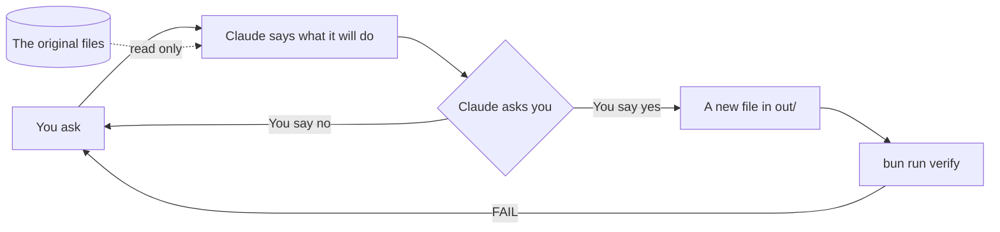

# Make Claude ask before it acts

This part moves you toward the course goal: Claude asks before it changes a file, and a script checks what it made.

## The problem

Claude can change files on your computer. In some modes it does this without asking you. Then you do not see what it is about to do.

Asking is not enough on its own. Anthropic found that people say yes to 93% of the prompts Claude shows them ([Anthropic, auto mode](https://www.anthropic.com/research/claude-code-auto-mode)). People click yes without reading.

So in this part you do two things. You make Claude ask first. And you check what it made with a script, not by trust.

For example, in Manual mode Claude stops before it makes `out/orders-clean.csv`. It shows you the file and asks. You read it, then you say yes or no.

Jess has two messy files. The order sheet came from three places. The price list has typos. You will clean both, and never touch the originals.



## The steps

| Step                                                              | Minutes | What you make                                          | What the check reads                               |
| ----------------------------------------------------------------- | ------- | ------------------------------------------------------ | -------------------------------------------------- |
| [read-the-folder](01-read-the-folder/problem/README.md)           | 15      | `out/whats-here.md`                                    | Every folder named, two questions, no file changed |
| [set-the-safety-rules](02-set-the-safety-rules/problem/README.md) | 10      | `.claude/settings.json` and `out/safety.md`            | Manual mode, no writes outside the folder          |
| [clean-the-orders](03-clean-the-orders/problem/README.md)         | 25      | `out/orders-clean.csv`                                 | Dates, cafe names, copies, counts, the original    |
| [fix-the-price-list](04-fix-the-price-list/problem/README.md)     | 15      | `out/price-list-clean.xlsx` and `out/price-changes.md` | Names, units, prices, the change list              |

## Walkthrough

From here on, open the `wren-street` folder in the Claude app, not the course folder. In the Code tab, click the folder button, pick **Open folder**, and choose `wren-street` inside the course folder.

Run each check from there:

```bash
bun run verify read-the-folder
```

Expect: `Done. All 5 rules pass.`

```bash
bun run verify set-the-safety-rules
```

Expect: `Done. All 7 rules pass.`

```bash
bun run verify clean-the-orders
```

Expect: `Done. All 10 rules pass.`

```bash
bun run verify fix-the-price-list
```

Expect: `Done. All 9 rules pass.`

To check the whole part at once:

```bash
bun run verify part make-claude-ask-first
```

Expect: `Part make-claude-ask-first is done: 4/4 steps pass.`
