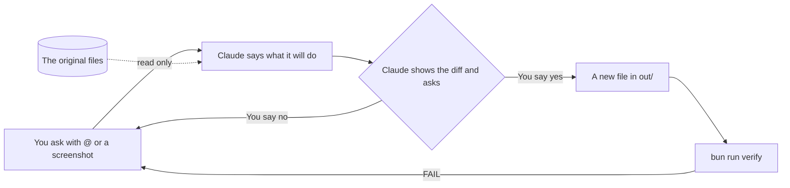

# Make Claude ask before it acts

## After this part you can

Make Claude ask before it changes a file, and check what it made with a script.

## You leave with

A settings file named `.claude/settings.json`. It has Manual mode, a deny rule and the sandbox on. You also leave with clean files in `out/` and notes on how you asked and what you reviewed.

## The problem

Claude can change files on your computer. In some modes it does this without asking you. Asking is not enough on its own: Anthropic found that people say yes to 93% of the prompts Claude shows them ([Anthropic, auto mode](https://www.anthropic.com/research/claude-code-auto-mode)). They click yes without reading. For example, a yes to a changed price list is easy to give and hard to undo. So you do two things. You make Claude ask first, and you read the change before you say yes. Then a script checks what it made, so you do not have to trust it.



## Steps

| Step                                                              | What you make                                                   | What the check reads                                       |
| ----------------------------------------------------------------- | --------------------------------------------------------------- | ---------------------------------------------------------- |
| [read-the-folder](01-read-the-folder/problem/README.md)           | `out/whats-here.md`, `out/prompts.md`, `out/screenshot-note.md` | Every folder named, an @ at a real file, a screenshot note |
| [set-the-safety-rules](02-set-the-safety-rules/problem/README.md) | `.claude/settings.json` and `out/safety.md`                     | Manual mode, no writes outside, a deny rule, the sandbox   |
| [clean-the-orders](03-clean-the-orders/problem/README.md)         | `out/orders-clean.csv` and `out/diff-note.md`                   | Dates, cafe names, copies, counts, a reviewed changed line |
| [fix-the-price-list](04-fix-the-price-list/problem/README.md)     | `out/price-list-clean.xlsx` and `out/price-changes.md`          | Names, units, prices, the change list                      |

## Walkthrough

From here on, open the `wren-street` folder in the Claude app, not the course folder. In the Code tab, click the folder button, pick **Open folder**, and choose `wren-street` inside the course folder.

To check, ask Claude to check your work. Say: "Run the check for the step name and tell me what it printed. Change nothing to make it pass." The [ways of working](../../00-orientation/ways-of-working.md) page lists every mode and command used here.

```bash
bun run verify read-the-folder
```

Expect: `Done. All 7 rules pass.`

```bash
bun run verify set-the-safety-rules
```

Expect: `Done. All 9 rules pass.`

```bash
bun run verify clean-the-orders
```

Expect: `Done. All 12 rules pass.`

```bash
bun run verify fix-the-price-list
```

Expect: `Done. All 9 rules pass.`

To check the whole part at once:

```bash
bun run verify part make-claude-ask-first
```

Expect: `Part make-claude-ask-first is done: 4/4 steps pass.`

## Watch and read

| Kind | Title                                    | Author                      | Why                                                                   | Link                                                           |
| ---- | ---------------------------------------- | --------------------------- | --------------------------------------------------------------------- | -------------------------------------------------------------- |
| read | How we built Claude Code auto mode       | Anthropic research          | Shows why people say yes without reading, and what to do about it.    | <https://www.anthropic.com/research/claude-code-auto-mode>     |
| read | Making Claude Code safer with sandboxing | Anthropic engineering blog  | Explains the walled room that the sandbox setting turns on.           | <https://www.anthropic.com/engineering/claude-code-sandboxing> |
| read | Configure permissions                    | Claude Code docs, Anthropic | The home of modes and deny rules, written by the team that made them. | <https://code.claude.com/docs/en/permissions>                  |
| read | Best practices for Claude Code           | Claude Code docs, Anthropic | Covers plan mode, @ files and screenshots as ways to ask well.        | <https://code.claude.com/docs/en/best-practices>               |
| read | Common workflows                         | Claude Code docs, Anthropic | Step by step uses of images, @ mentions and reviewing changes.        | <https://code.claude.com/docs/en/common-workflows>             |

## Project

Pick one sheet from your own work, such as a list, a log or a price file. Work on a copy. In a new folder, save a settings file with Manual mode, a deny rule for one private folder, and the sandbox on. Then ask Claude to clean the copy with an @ mention. Read its diff before you say yes. Save a short note that names one changed line and why it is right.
