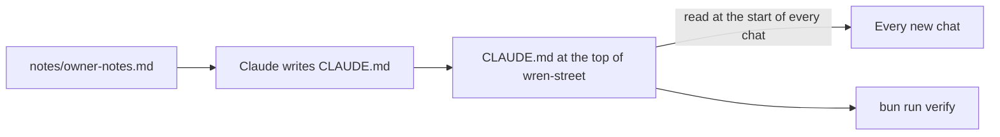
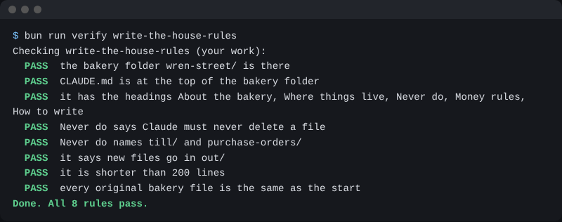

# Write the house rules

## The problem

Each new chat, Claude starts fresh. It does not know Jess, the six cafes, or the rule about the till. So you say the same things again and again. And on the one day you forget, Claude may change a file it should not touch.

Claude Code fixes this with one file: `CLAUDE.md`. Claude reads it at the start of every chat. Anthropic's guide says to keep it under 200 lines, because "longer files consume more context and reduce adherence" ([Anthropic, memory](https://code.claude.com/docs/en/memory.md)). In plain words: Claude follows a short list better than a long one.



## Your challenge

Stay in Manual mode. Paste this to Claude:

```text
Read notes/owner-notes.md and look at the folders here. Then write
CLAUDE.md at the top of this folder, not in out/. It holds the house
rules for Wren Street Bakery. Use these five headings: About the bakery,
Where things live, Never do, Money rules, How to write. Under Never do,
say: never delete a file, and never change anything in till/ or
purchase-orders/. Say that every new file goes in out/. Keep it short,
under 50 lines, so you will read all of it.
```

Claude asks before it makes the file. Read it first. Is every rule true for the bakery? Is anything missing?

For example, Jess's notes say "Never email a cafe without asking me first." That rule belongs under **Never do**.

Then start a new chat and type `/memory`. You see `CLAUDE.md` in the list. Ask "What must you never do here?" Claude answers from the file.

## Done when

- `CLAUDE.md` is at the top of the bakery folder.
- It has the five headings.
- Never do says: never delete a file, and never change `till/` or `purchase-orders/`.
- It says new files go in `out/`.
- It is shorter than 200 lines.

```bash
bun run verify write-the-house-rules
```

Expect: `Done. All 8 rules pass.`



## If you get stuck

| What you see                                        | Try this                                                              |
| --------------------------------------------------- | --------------------------------------------------------------------- |
| `FAIL CLAUDE.md is at the top of the bakery folder` | Claude put it in `out/`. Ask it to save it next to `orders/` instead. |
| `FAIL Never do names till/ and purchase-orders/`    | Ask Claude to add both folders to the Never do list.                  |
| `FAIL it is shorter than 200 lines`                 | Ask Claude to keep only the rules that matter.                        |

A rule in `CLAUDE.md` is a strong hint, not a lock. Anthropic says Claude treats it "as context, not enforced configuration". So you still check the work.

## Words you will use

- **CLAUDE.md**: a file of house rules. Claude Code reads it at the start of each chat.
- **/memory**: a command you type in Claude Code. It lists the rule files Claude has read.
- **Context**: what Claude has read so far in this chat.
