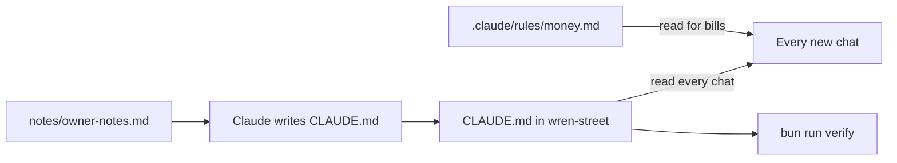

# Write the house rules

## The problem

Each new chat, Claude starts fresh. It does not know Jess, the six cafes, or the rule about the till, so you say it all again. One file fixes this: `CLAUDE.md`. Claude reads it at the start of every chat ([Anthropic, memory](https://code.claude.com/docs/en/memory.md)).



## Watch it done

For example, before, a new chat guesses what it must never do. After, it answers from the file. The check prints:

```text
Done. All 12 rules pass.
```


## Your turn

Stay in Manual mode, where Claude asks before each change.

1. Paste this to Claude:

```text
Read notes/owner-notes.md and look at the folders here. Then write
CLAUDE.md at the top of this folder, not in out/, with the headings
About the bakery, Where things live, Never do, Money rules, How to write.
Under Never do: never delete a file, and never change anything in till/
or purchase-orders/. Every new file goes in out/. Keep it short. Add one
line: one task per chat, and use /clear or a new chat between tasks.
```

Expect: Claude asks before it makes the file. Read it, and say yes when every rule is true.

2. Type `/init`. This command makes Claude read the folder and suggest a `CLAUDE.md` of its own. Do not say yes yet.

Expect: Claude shows its own version or changes to yours.

3. Ask Claude to save `out/init-compare.md` with a line `Same:` and a line `Different:`, and to mention `/init`.

Expect: a note on what matched and what `/init` missed.

4. Ask Claude for `.claude/rules/money.md`. A rules file holds rules Claude reads only for matching files. Start it with a `paths:` list naming `invoices/**` and `purchase-orders/**`.

Expect: a small file with a `paths:` list.

5. Type `/clear`, then `/memory`.

Expect: `CLAUDE.md` is listed. The `/clear` command wipes the chat, and the file loads again. The `/memory` command lists the files Claude has read.

## Do it on your work

Do the same in your own folder, with a rules file for your most careful folder. Good looks like a short file with every rule true.

## Done when

- `CLAUDE.md` has the five headings, the never-do list, `out/`, and the `/clear` line.
- `out/init-compare.md` has both labels.
- `.claude/rules/` holds a file with real rules and a `paths:` list or a topic heading.

To check, ask Claude:

```text
Please check my work for write-the-house-rules. Run bun run verify write-the-house-rules and tell me what it printed. Do not change anything to make it pass.
```

It runs:

```bash
bun run verify write-the-house-rules
```

Expect: `Done. All 12 rules pass.`

## Solution

The finished files are in `solution/`.

## If you get stuck

| What you see                                        | Try this                                              |
| --------------------------------------------------- | ----------------------------------------------------- |
| `FAIL out/init-compare.md names /init ...`          | Write both labels, with a few words after each.       |
| `FAIL .claude/rules/ holds a rule file ...`         | The file is empty. Ask Claude for four short rules.   |

A rule is a strong hint, not a lock. You still check the work.

## Words you will use

- **CLAUDE.md**: a file of house rules that Claude reads at the start of each chat.
- **/init**: a command that makes Claude suggest a `CLAUDE.md` from the folder.
- **Rules file**: a small file in `.claude/rules/`, read when its `paths:` match.
