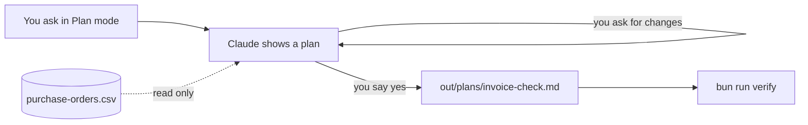

# Plan the invoice check

## The problem

Next, Claude checks 24 supplier bills. That is money, and a wrong answer said with confidence costs real pounds. For example, a weak plan might say "fix the purchase order to match the bill". In Plan mode you see that before anything changes.



## Watch it done

Before, Claude would start reading bills at once. After, it shows a plan with five headings and waits. The plan says which file is the truth, and the check prints:

```text
Done. All 6 rules pass.
```


## Your turn

The example file is `purchase-orders/purchase-orders.csv`. A purchase order is what Jess ordered, and the price she agreed.

1. Press Shift+Tab until the terminal says plan mode. In Plan mode Claude reads and thinks, but changes no file. In the app, use the mode button.

Expect: the mode line says plan.

2. Paste this:

```text
We will check the 24 supplier invoices in invoices/ against
purchase-orders/purchase-orders.csv. Do not do the check yet.
Make a plan with these headings: Goal, Files I will read,
Files I will write, Steps, Risks. Say which file is the source of truth.
```

Expect: a plan with the five headings. The source of truth is the file that wins when two files disagree.

3. Read it. Does it name `purchase-orders.csv` as the truth? Does every file it will write sit in `out/`? Ask for changes until yes, then say yes.

Expect: Claude leaves Plan mode.

4. Paste this:

```text
Save the plan you showed me as out/plans/invoice-check.md.
Do not start the check.
```

Expect: the file `out/plans/invoice-check.md` appears.

## Do it on your work

Pick a job in your own folder that touches money or many files. Ask for a plan first, with the same five headings. Good looks like a plan that names one file as the truth and writes only to a safe folder. It should also name a risk you had not thought of.

## Done when

- The plan is saved, with the five headings.
- It names `purchase-orders.csv` as the source of truth.
- Every file under Files I will write is in `out/`.
- No original bakery file has changed.

To check, ask Claude:

```text
Please check my work for plan-the-invoice-check. Run bun run verify plan-the-invoice-check and tell me what it printed. Do not change anything to make it pass.
```

It runs:

```bash
bun run verify plan-the-invoice-check
```

Expect: `Done. All 6 rules pass.`

## Solution

The saved plan is in `solution/out/plans/invoice-check.md`.

## If you get stuck

| What you see                                               | Try this                                                        |
| ---------------------------------------------------------- | --------------------------------------------------------------- |
| `FAIL it names purchase-orders.csv as the source of truth` | Ask which file wins when a bill and an order differ.            |
| `FAIL Files I will write names at least one file ...`      | Claude wants to change an original. Say no, and ask for `out/`. |
| `FAIL out/plans/invoice-check.md is there`                 | Ask Claude to save the plan.                                    |
