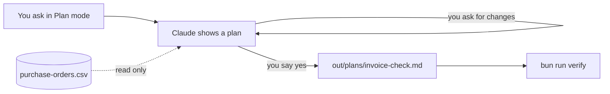
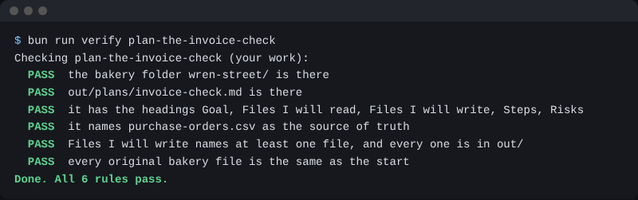

# Plan the invoice check

## The problem

Next, Claude checks 24 supplier bills. That is money. A wrong answer said with confidence can cost Jess real pounds. So before Claude does any work, you want to see its plan.

A plan shows you the mistake before it happens. For example, a weak plan says "fix the purchase order to match the bill". That would change the bakery's record. You catch it in the plan, and nothing has changed yet.

In Plan mode, Claude reads and thinks, but it does not change files. It shows you a plan. You say yes, or you ask for changes.



## Your challenge

Switch Claude to **Plan** mode. In the terminal, press Shift+Tab until it says plan mode. In the app, use the mode button. Then paste this:

```text
We will check the 24 supplier invoices in invoices/ against
purchase-orders/purchase-orders.csv. Do not do the check yet.
Make a plan with these headings: Goal, Files I will read,
Files I will write, Steps, Risks. Say which file is the source of truth.
```

Read the plan. Check three things:

- Does it say `purchase-orders.csv` is the source of truth?
- Does every file it will write sit in `out/`?
- Does it name a risk you did not think of?

If the answer is no, tell Claude what to change. When the plan is right, say yes. Claude leaves Plan mode. Then paste this:

```text
Save the plan you showed me as out/plans/invoice-check.md.
Do not start the check.
```

## Done when

- `out/plans/invoice-check.md` is there, with the five headings.
- It names `purchase-orders.csv` as the source of truth.
- Every file under Files I will write is in `out/`.
- No original bakery file has changed.

To check, ask Claude:

```text
Please check my work for plan-the-invoice-check. Run bun run verify plan-the-invoice-check and tell me what it printed. Do not change anything to make it pass.
```

It runs:

```bash
bun run verify plan-the-invoice-check
```

Expect: `Done. All 6 rules pass.`



## If you get stuck

| What you see                                                                | Try this                                                           |
| --------------------------------------------------------------------------- | ------------------------------------------------------------------ |
| `FAIL it names purchase-orders.csv as the source of truth`                  | Ask Claude to say which file wins when a bill and an order differ. |
| `FAIL Files I will write names at least one file, and every one is in out/` | Claude wants to change an original. Say no, and ask for `out/`.    |
| `FAIL out/plans/invoice-check.md is there`                                  | Claude made the plan but did not save it. Ask it to save it.       |

## Words you will use

- **Plan mode**: Claude reads and plans, but changes no file until you say yes.
- **Source of truth**: the file that wins when two files disagree.
- **Purchase order**: what Jess ordered from a supplier, and the price she agreed.
