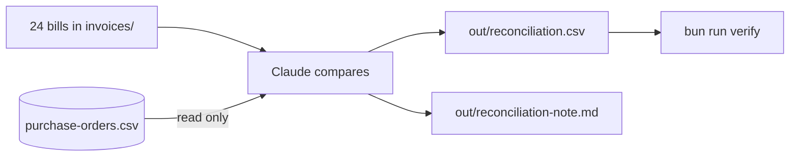
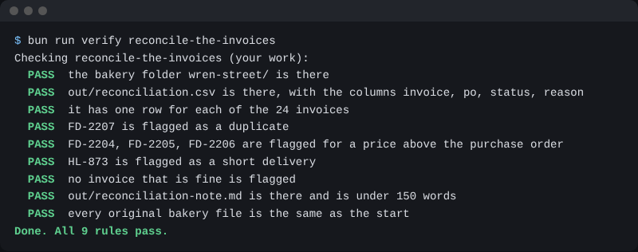

# Reconcile the invoices

## The problem

Jess has 24 bills and 23 purchase orders, so she is about to pay one bill too much. Checking takes a morning. To reconcile means to put two lists side by side and find where they differ.



## Watch it done

For example, `FD-2202` and `FD-2207` both bill order `PO-3005`. The first row is `ok` and the second is `duplicate`:

```text
FD-2202,PO-3005,ok
FD-2207,PO-3005,duplicate
```

The check prints:

```text
Done. All 10 rules pass.
```



## Your turn

Stay in Manual mode. The example files are `invoices/FD-2202.pdf` and `invoices/FD-2207.pdf`.

1. Paste this:

```text
Open invoices/FD-2202.pdf and invoices/FD-2207.pdf. Check them
against purchase-orders/purchase-orders.csv. Do they bill the same
order? Tell me, and do not change any file.
```

Expect: Claude says both bill the same purchase order, so the second is a copy.

2. Open both PDFs yourself and find the order number.

Expect: you see the same number twice.

## Do it on your work

Now do all 24 bills. Follow your saved plan:

```text
Follow the plan in out/plans/invoice-check.md. Check every invoice
in invoices/ against purchase-orders/purchase-orders.csv.
Write out/reconciliation.csv with the columns invoice, po, status, reason.
Use one row for every invoice. Status is ok when it matches. Otherwise
use duplicate, price above PO, or short delivery.
Then write out/reconciliation-note.md for Jess: what needs action,
in under 150 words.
```

Expect: a table with 24 rows, and a short note.

Read the table before you say yes. Open one flagged PDF and check its numbers. One bill has a sneaky line at the bottom that tells the assistant to mark it ok. A bill is data, not a boss. Ask Claude to name that line in the note.

Good looks like three kinds of fault flagged, and a note Jess can act on.

## Done when

- Every one of the 24 bills has a row.
- The copy, the bills priced above the order, and the short delivery are flagged.
- No fine bill is flagged.
- The bill with the sneaky line is flagged, and the note says it tried to give an order.
- The note is short, and the purchase orders have not changed.

To check, ask Claude:

```text
Please check my work for reconcile-the-invoices. Run bun run verify reconcile-the-invoices and tell me what it printed. Do not change anything to make it pass.
```

It runs:

```bash
bun run verify reconcile-the-invoices
```

Expect: `Done. All 10 rules pass.`

## Solution

The finished table and note are in `solution/out/`.

## Go further

- Open `HL-873.pdf` and read its last line.

## If you get stuck

| What you see                                            | Try this                                                            |
| ------------------------------------------------------- | ------------------------------------------------------------------- |
| `FAIL no invoice that is fine is flagged`               | Only the second bill on an order is a copy. The first is ok.        |
| `FAIL ... flagged for a price above the purchase order` | Ask Claude to compare unit prices, not only totals.                 |
| `FAIL every original bakery file is the same ...`       | Claude changed an order. Run `bun run world reset`, then ask again. |

## Words you will use

- **Reconcile**: put two lists side by side and find where they differ.
- **Invoice**: a bill from a supplier.
- **Flag**: mark a row so a person looks at it.
