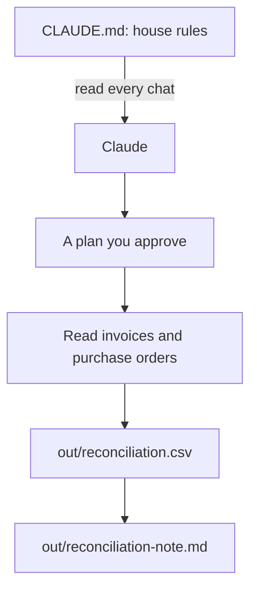

# Teach Claude the bakery

## The problem

Each new chat, Claude forgets the bakery. It does not know that the purchase orders are the truth, or that Jess never wants a cafe emailed. And a wrong answer said with confidence can cost real money.

A bookkeeping firm in Dallas had a client with a $13,000 gap in its books. Claude helped find "the exact 16 transactions" behind it ([HireEffect, in Anthropic's small business post](https://claude.com/blog/claude-for-small-business-launches-new-workflows-integrations-and-training-programs)).

In this part you write the house rules once. Then you make Claude show a plan before it touches money. Then it checks 24 supplier bills against what Jess ordered.



## The steps

| Step | Minutes | What you make | What the check reads |
|---|---|---|---|
| write-the-house-rules | 20 | `CLAUDE.md` | Its parts, the never-do list, `out/` named, under 200 lines |
| plan-the-invoice-check | 10 | `out/plans/invoice-check.md` | Goal, files to read and write, steps, risks; nothing else changed |
| reconcile-the-invoices | 30 | `out/reconciliation.csv` and a short note | Every planted fault flagged, no false flags |

## Walkthrough

TODO(part session): one paragraph per step and its exact Expect line.

```bash
bun run verify part teach-the-bakery
```

Expect: TODO(part session)
