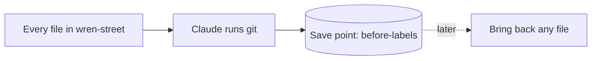

# Make a save point

## The problem

For example, Claude will soon make labels in your bakery folder. If one change goes wrong, you need a copy made earlier.

A **save point** is a copy of every file, as it is right now.



## Watch it done

Before, the folder has no save points. Ask "What save points do I have?" and Claude has nothing to show.

After, Claude runs `git log` and prints one line:

```text
before-labels
```

**git** is the tool Claude uses. You ask in plain words and Claude runs it.

## Your turn

Stay in Manual mode, so Claude asks before each command. The example files are `menu/menu.md` and `notes/owner-notes.md`. The save point holds them and every other file.

1. Open a terminal in `wren-street` and type `claude`.
2. Paste this prompt:

   ```text
   Make this folder a git repository, so I can make save points.
   Then make a save point of every file, called before-labels.
   Keep out/ in the save point too. Tell me each command before you run it.
   ```

   Expect: Claude asks to run `git init`. Say yes.
3. Say yes to `git add` and `git commit`.
   Expect: Claude says the save point is made.
4. Ask: "What save points do I have?"
   Expect: one line, `before-labels`.

## Do it on your work

Do the same in a folder of your own, such as a budget or a pile of notes. Paste the same prompt with your own name for the save point. Good looks like this: the log shows your name, and no folder is left out.

## Done when

- The bakery folder has its own save points, made in `wren-street` and not in the course folder.
- Every original file is in the save point.
- Your work in `out/` is in it too.

To check, ask Claude: "Please check my work for make-a-save-point. Run the command and tell me what it printed. Do not change anything to make it pass."

```bash
bun run verify make-a-save-point
```

Expect: `Done. All 6 rules pass.`

## Solution

The after state is a `.save-point/` record of what git printed, plus the prompt. Find them in `solution/`.


## Go further

- Make a second save point after you change a file.

## If you get stuck

| What you see                                      | Try this                                                                                          |
| ------------------------------------------------- | ------------------------------------------------------------------------------------------------- |
| `FAIL the bakery folder has its own save points`  | Open `wren-street` in Claude, not the course folder. Then ask again.                              |
| `FAIL your work in out/ is in the save point too` | Claude hid `out/` in a file called `.gitignore`. Ask it to take that out.                         |
| `git: command not found`                          | Ask Claude to install git for you, then try again.                                                |
| Git asks who you are                              | Git needs a name for each save point. Ask Claude to set your name and email for this folder only. |

## Words you will use

- **Save point**: a copy of every file at one moment. You can bring any file back from it.
- **git**: the tool Claude uses to make save points.
- **Commit**: what git calls one save point.
