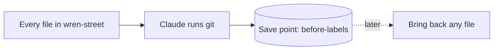
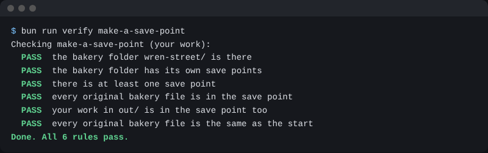

# Make a save point

## The problem

So far, Claude has made new files in `out/`. Next, it makes labels and reports. Some day, a change will go wrong. You want a way back to a moment when everything was fine.

A **save point** is a copy of every file in the folder, as it is right now. Later, you can bring back any file from it. It is like saving a game before a hard level.

Claude makes save points with a tool called **git**. You do not need to learn git. You ask in plain words, and Claude runs it for you.



## Your challenge

Stay in Manual mode. Paste this:

```text
Make this folder a git repository, so I can make save points.
Then make a save point of every file, called before-labels.
Keep out/ in the save point too. Tell me each command before you run it.
```

Claude asks before each command. Read it, then say yes. For example, Claude asks to run `git init`. That makes the folder ready for save points. Then it asks to run `git add` and `git commit`. Those make the save point.

Then ask: "What save points do I have?" Claude runs `git log` and shows one line: `before-labels`.

Make sure the save point is made in `wren-street`, not in the course folder around it.

## Done when

- The bakery folder has its own save points.
- There is at least one save point.
- Every original file is in it.
- Your work in `out/` is in it too.

```bash
bun run verify make-a-save-point
```

Expect: `Done. All 6 rules pass.`



## If you get stuck

| What you see                                      | Try this                                                                  |
| ------------------------------------------------- | ------------------------------------------------------------------------- |
| `FAIL the bakery folder has its own save points`  | Open `wren-street` in Claude, not the course folder. Then ask again.      |
| `FAIL your work in out/ is in the save point too` | Claude hid `out/` in a file called `.gitignore`. Ask it to take that out. |
| `git: command not found`                          | Ask Claude to install git for you, then try again.                        |

## Words you will use

- **Save point**: a copy of every file at one moment. You can bring any file back from it.
- **git**: the tool Claude uses to make save points.
- **Commit**: what git calls one save point.
