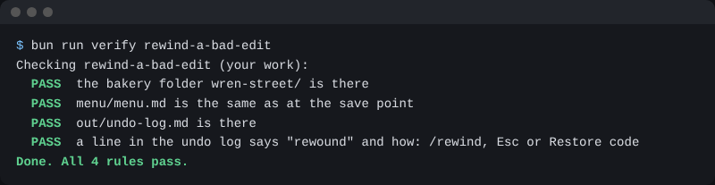

# Rewind a bad edit

## The problem

For example, Claude turns the Sourdough Loaf price on the wall menu from £4.00 to £4.20 by mistake, and a customer pays too much.

Rewind is the way back. Claude Code saves a **checkpoint** before each prompt you send. Rewind takes your files back to one of them.


## Watch it done

Before, `menu/menu.md` has this line after a bad edit:

```text
Sourdough Loaf   £4.20
```

After you type `/rewind` and pick **Restore code**, the same line reads:

```text
Sourdough Loaf   £4.00
```

## Your turn

Rewind lives in Claude Code in the terminal. The two files are `menu/menu.md` and `out/undo-log.md`.

1. Open a terminal in `wren-street` and type `claude`.
2. Paste this prompt:

   ```text
   This is a practice edit. I will undo it.
   In menu/menu.md, change the Sourdough Loaf price to £4.20.
   ```

   Expect: Claude asks first. Say yes. Then the menu says £4.20.
3. Type `/rewind`. You can also press Esc twice. Both open the same list.
   Expect: a list of your prompts.
4. Pick the practice edit prompt and choose **Restore code**.
   Expect: the menu says £4.00 again.
5. Paste this prompt:

   ```text
   Start out/undo-log.md with the heading "Undo log". Add this line:
   - menu.md: Claude changed the Sourdough Loaf price to £4.20.
   I rewound with /rewind and Restore code. The menu is back to £4.00.
   ```

   Expect: `out/undo-log.md` holds a line with the word "rewound".

## Do it on your work

Ask Claude to make one small edit to a file of your own, such as a heading in a note. Press Esc twice or type `/rewind`, pick that prompt, and choose **Restore code**. Good looks like this: the file reads exactly as before, and your log names the file and says how you undid it.

## Done when

- `menu/menu.md` is the same as at the save point.
- `out/undo-log.md` has a line that says "rewound" and how: `/rewind`, Esc or Restore code.

To check, ask Claude: "Please check my work for rewind-a-bad-edit. Run the command and tell me what it printed. Do not change anything to make it pass."

```bash
bun run verify rewind-a-bad-edit
```

Expect: `Done. All 4 rules pass.`

## Solution

The after state is a menu that says £4.00 and an undo log. Both are in `solution/`.



## Go further

- Press Esc once while Claude is working, to stop it, and see what it did so far.

## If you get stuck

| What you see                                         | Try this                                                                         |
| ---------------------------------------------------- | -------------------------------------------------------------------------------- |
| `FAIL menu/menu.md is the same as at the save point` | Claude typed the menu back in, and a small thing changed. Rewind it instead.     |
| The rewind list has no **Restore code**              | You picked a prompt with no file change after it. Pick the practice edit prompt. |

## Words you will use

- **Checkpoint**: what Claude Code saves before each prompt you send.
- **Rewind**: go back to a checkpoint. Type `/rewind`, or press Esc twice.
- **Restore code**: the rewind choice that puts the files back.
