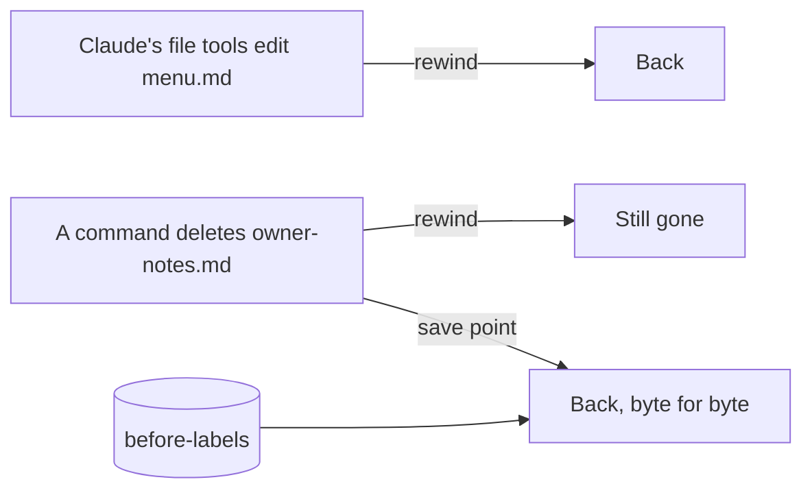

# Recover a deleted file

## The problem

For example, Anthropic's guide says: "A file that only Bash commands changed isn't tracked and stays as it is" ([Anthropic, checkpointing](https://code.claude.com/docs/en/checkpointing)). So when a **command** deletes a file, rewind cannot bring it back. Only a save point can.



## Watch it done

Before, a command deleted `notes/owner-notes.md`. Rewind shows no **Restore code** for it.

After, Claude restores it from the save point, and the log says why:

```text
- owner-notes.md: a command (rm) deleted it. Rewind could not bring it
back, because Claude's file tools never touched it. I got it back from
the save point before-labels.
```

## Your turn

The two files are `notes/owner-notes.md` and `out/undo-log.md`. You have a save point, so this practice is safe.

1. In Claude Code in the terminal, paste this prompt:

   ```text
   This is a practice. I have a save point. Run this command:
   rm notes/owner-notes.md
   ```

   Expect: Claude asks before it runs the command. Say yes. The file is gone.
2. Type `/rewind` and read the list.
   Expect: no **Restore code** for the notes. Claude's file tools never touched them.
3. Paste this prompt:

   ```text
   Bring back notes/owner-notes.md from the save point before-labels.
   Do not write it again from memory. Then add this line to out/undo-log.md:
   - owner-notes.md: a command (rm) deleted it. Rewind could not bring it
   back, because Claude's file tools never touched it. I got it back from
   the save point before-labels.
   ```

   Expect: Claude asks to run a git command that restores the file. Say yes.
4. Ask Claude to show the notes.
   Expect: the same words as before.

## Do it on your work

Pick a spare file you saved earlier. Ask Claude to delete it with a command, then restore it from your save point. Good looks like this: the file is back with every letter the same.

## Done when

- `notes/owner-notes.md` is back, byte for byte the same as the save point.
- A line in `out/undo-log.md` names `owner-notes.md` and says a command deleted it.
- Every other original file is the same as the start.

To check, ask Claude: "Please check my work for recover-a-deleted-file. Run the command and tell me what it printed. Do not change anything to make it pass."

```bash
bun run verify recover-a-deleted-file
```

Expect: `Done. All 5 rules pass.`

## Solution

The after state is the notes back and a log. Both are in `solution/`.

## Go further

- Ask Claude to write a hook that blocks any delete outside `out/`. A hook is a small script Claude Code runs before each tool.

## If you get stuck

| What you see                                                            | Try this                                                                   |
| ----------------------------------------------------------------------- | -------------------------------------------------------------------------- |
| `FAIL notes/owner-notes.md is byte for byte the same as the save point` | Claude wrote the notes again from memory. Ask it to restore them with git. |
| `FAIL notes/owner-notes.md is back`                                     | Ask Claude to restore the file from the save point.                        |
| Claude says there is no save point                                      | Go back to make-a-save-point. Run `bun run world reset` first if you must. |

## Words you will use

- **Command**: an instruction Claude runs in the terminal, like `rm` to delete a file.
- **Byte for byte**: every letter and space is the same as before.
- **Restore**: bring a file back as it was.
