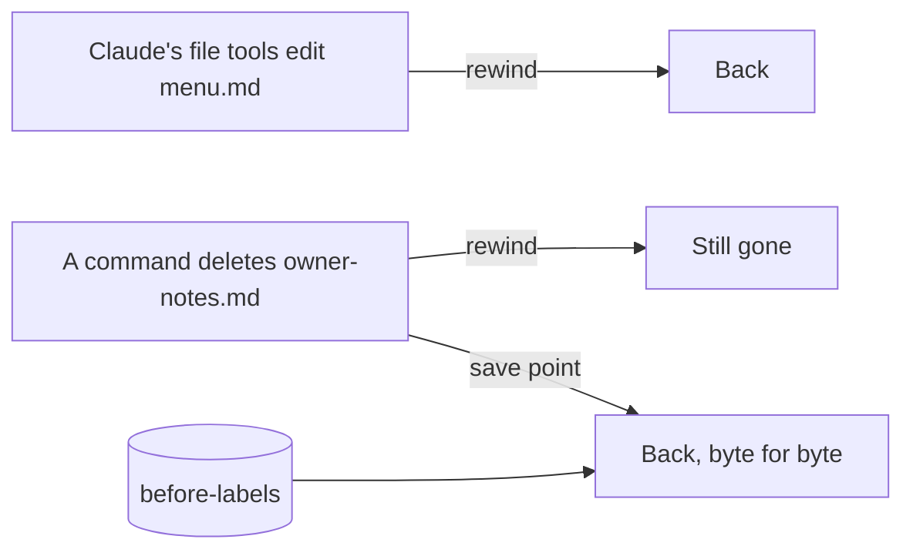

# Recover a deleted file

## The problem

Rewind has a gap. Anthropic's guide says: "A file that only Bash commands changed isn't tracked and stays as it is."

To get such a file back, the guide says to use "version control, such as Git" ([Anthropic, checkpointing](https://code.claude.com/docs/en/checkpointing.md)).

In plain words: when Claude runs a **command** that deletes a file, rewind cannot bring it back. Only a save point can.

People have lost real files this way. One person asked Claude to clean up files left by old apps. A wrong delete command removed about 275 GB from their drive ([GitHub issue 106205](https://github.com/anthropics/claude-code/issues/106205)).



## Your challenge

You delete Jess's notes on purpose, with a command. You have a save point, so this is safe.

In Claude Code in the terminal, paste this:

```text
This is a practice. I have a save point. Run this command:
rm notes/owner-notes.md
```

Claude asks before it runs the command. It may warn you. Say yes. The file is gone.

Now type `/rewind` and look at the list. For example, you see the prompt "This is a practice. I have a save point." Pick it. You see no **Restore code** for the notes. Claude's file tools never touched the notes, so rewind has nothing to restore.

Now paste this:

```text
Bring back notes/owner-notes.md from the save point before-labels.
Do not write it again from memory. Then add this line to out/undo-log.md:
- owner-notes.md: a command (rm) deleted it. Rewind could not bring it
back, because Claude's file tools never touched it. I got it back from
the save point before-labels.
```

Claude asks to run a git command that restores the file. Say yes.

## Done when

- `notes/owner-notes.md` is back, byte for byte the same as the save point.
- A line in `out/undo-log.md` names `owner-notes.md` and says a command deleted it.
- Every other original file is the same as the start.

```bash
bun run verify recover-a-deleted-file
```

Expect: `Done. All 5 rules pass.`

## If you get stuck

| What you see                                                            | Try this                                                                   |
| ----------------------------------------------------------------------- | -------------------------------------------------------------------------- |
| `FAIL notes/owner-notes.md is byte for byte the same as the save point` | Claude wrote the notes again from memory. Ask it to restore them with git. |
| `FAIL notes/owner-notes.md is back`                                     | Ask Claude to restore the file from the save point.                        |
| Claude says there is no save point                                      | Go back to make-a-save-point. Run `bun run world reset` first if you must. |

## Words you will use

- **Command**: an instruction Claude runs in the terminal, like `rm` to delete a file.
- **Byte for byte**: every letter and space is the same as before.
- **Restore**: bring a file back as it was.
