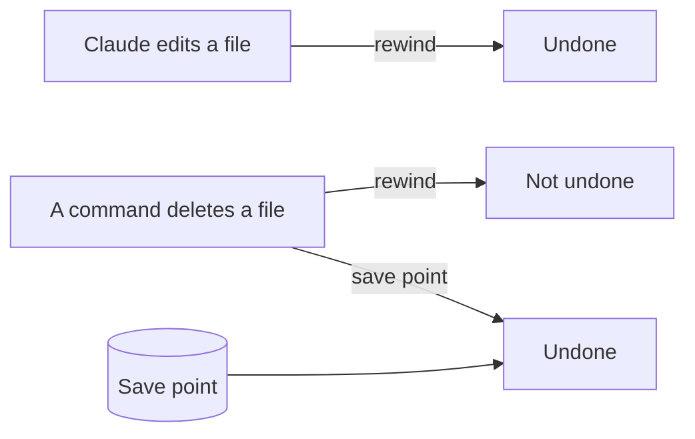

# Undo anything

This part moves you toward the course goal: you can undo any change Claude makes, so a mistake never costs you a file.

## The problem

Claude can undo its own edits with rewind. But rewind has a gap. Anthropic's own guide says: "A file that only Bash commands changed isn't tracked and stays as it is." It also keeps only the 100 most recent checkpoints ([Anthropic, checkpointing](https://code.claude.com/docs/en/checkpointing.md)).

So if a command deletes a file, rewind cannot bring it back. You need a save point you made before.

For example, say Claude edits `menu/menu.md`. Rewind puts it back. But say a command deletes `notes/owner-notes.md`. Rewind cannot bring it back. Your save point can.

In this part you make a save point, undo a bad edit with rewind, and get back a file that rewind cannot reach.



## The steps

| Step                                                                  | Minutes | What you make                                                     | What the check reads                                                |
| --------------------------------------------------------------------- | ------- | ----------------------------------------------------------------- | ------------------------------------------------------------------- |
| [make-a-save-point](01-make-a-save-point/problem/README.md)           | 10      | A save point in the bakery folder                                 | Its own save points; every original and `out/` saved                |
| [rewind-a-bad-edit](02-rewind-a-bad-edit/problem/README.md)           | 10      | A bad edit to the menu, then rewound; a line in `out/undo-log.md` | The menu is the same as the save point; the log says how            |
| [recover-a-deleted-file](03-recover-a-deleted-file/problem/README.md) | 15      | The owner notes deleted by a command, then got back               | The notes are back byte for byte; the log says why rewind could not |

## Walkthrough

Open the `wren-street` folder in Claude Code. Stay in Manual mode. The last two steps use rewind, so do them in Claude Code in the terminal: open a terminal in `wren-street` and type `claude`.

To check, ask Claude to check your work. Say: "Please check my work for the step name. Run it and tell me what it printed. Do not change anything to make it pass." The commands below are what Claude runs. The [ways of working](../../00-orientation/ways-of-working.md) page lists every mode and command used here.

First, ask Claude to make a save point called `before-labels`. Say yes to each git command after you read it.

```bash
bun run verify make-a-save-point
```

Expect: `Done. All 6 rules pass.`

Next, ask Claude for a practice edit to the menu. Then type `/rewind` and choose **Restore code**. Ask Claude to write what you did in `out/undo-log.md`.

```bash
bun run verify rewind-a-bad-edit
```

Expect: `Done. All 4 rules pass.`

Last, ask Claude to delete the owner notes with `rm`. See that rewind cannot help. Then ask Claude to bring the notes back from the save point.

```bash
bun run verify recover-a-deleted-file
```

Expect: `Done. All 5 rules pass.`

To check the whole part at once:

```bash
bun run verify part undo-anything
```

Expect: `Part undo-anything is done: 3/3 steps pass.`

## Hand it in

Hand in your save point list (what `git log` prints in `wren-street`) and `out/undo-log.md`. A grader answers each question yes or no:

1. Does `bun run verify make-a-save-point` pass?
2. Does `bun run verify rewind-a-bad-edit` pass?
3. Does `bun run verify recover-a-deleted-file` pass, with the notes byte for byte the same as the save point?
4. Does the undo log say, in your words, why rewind could not bring the notes back?

Go further: ask Claude to write a hook that blocks any delete outside `out/`. A hook is a small script Claude Code runs before each tool. Then ask Claude to delete a file outside `out/`, and add a line to `out/undo-log.md` about the blocked attempt.

## FINISHED

You now have a save point of the whole bakery, and you know two ways back. Rewind undoes Claude's own edits. The save point brings back anything, even a file a command deleted.

So you can let Claude do bigger jobs. The next part is [Do it the same way every time](../04-repeat-the-work/README.md). There you teach Claude to make the shelf labels as a skill. Then a person signs each one.
