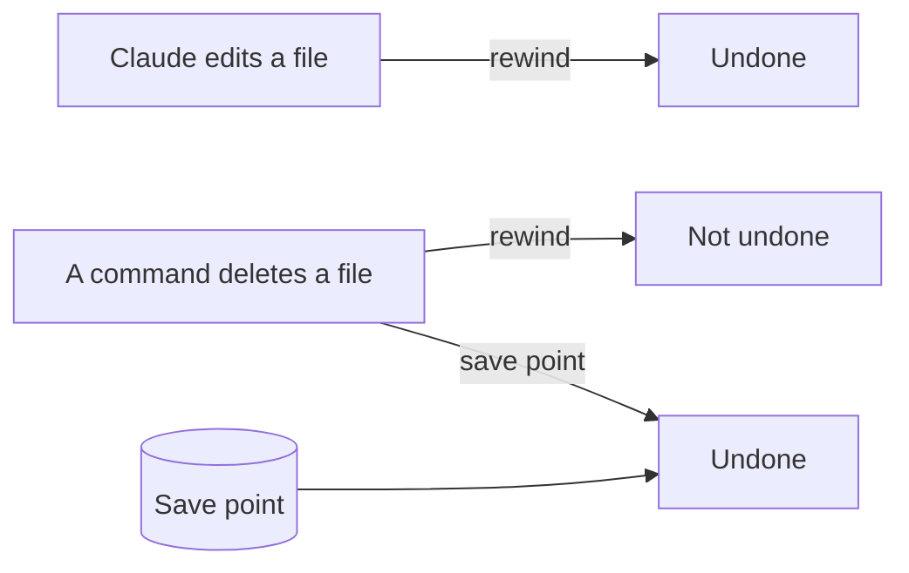

# Undo anything

## The problem

Claude can undo its own edits with rewind. But rewind has a gap. Anthropic's own guide says: "A file that only Bash commands changed isn't tracked and stays as it is." It also keeps only the 100 most recent checkpoints ([Anthropic, checkpointing](https://code.claude.com/docs/en/checkpointing.md)).

So if a command deletes a file, rewind cannot bring it back. You need a save point you made before.

In this part you make a save point, undo a bad edit with rewind, and get back a file that rewind cannot reach.



## The steps

| Step | Minutes | What you make | What the check reads |
|---|---|---|---|
| make-a-save-point | 10 | A save point in the bakery folder | At least one save point, nothing left unsaved |
| rewind-a-bad-edit | 10 | A bad edit to the menu, then rewound; a line in `out/undo-log.md` | The menu is the same as the save point; the log says how |
| recover-a-deleted-file | 15 | The owner notes deleted by a command, then got back | The notes are back byte for byte; the log says why rewind could not |

## Walkthrough

TODO(part session): one paragraph per step and its exact Expect line.

```bash
bun run verify part undo-anything
```

Expect: TODO(part session)
