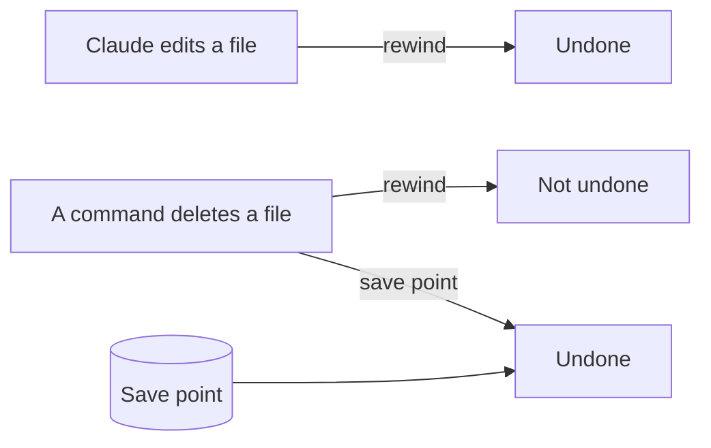

# Undo anything

## After this part you can

Undo any change Claude makes, so a mistake never costs you a file.

## You leave with

A save point of the whole bakery folder, and an undo log in `out/undo-log.md`.

## The problem

Rewind can undo Claude's own edits. For example, Anthropic's guide says: "A file that only Bash commands changed isn't tracked and stays as it is" ([Anthropic, checkpointing](https://code.claude.com/docs/en/checkpointing)). So if a command deletes a file, rewind cannot bring it back. You need a save point you made before.



## Steps

| Step                                                                  | What you make                                                     | What the check reads                                                |
| --------------------------------------------------------------------- | ----------------------------------------------------------------- | ------------------------------------------------------------------- |
| [make-a-save-point](01-make-a-save-point/problem/README.md)           | A save point in the bakery folder                                 | Its own save points; every original and `out/` saved                |
| [rewind-a-bad-edit](02-rewind-a-bad-edit/problem/README.md)           | A bad edit to the menu, then rewound; a line in `out/undo-log.md` | The menu is the same as the save point; the log says how            |
| [recover-a-deleted-file](03-recover-a-deleted-file/problem/README.md) | The owner notes deleted by a command, then got back               | The notes are back byte for byte; the log says why rewind could not |

Plan for an evening.

## Walkthrough

Open the `wren-street` folder in Claude Code and stay in Manual mode. The last two steps use rewind, so open a terminal in `wren-street` and type `claude`. The [ways of working](../../00-orientation/ways-of-working.md) page lists every mode and command used here.

Ask Claude to make a save point called `before-labels`. Say yes to each git command after you read it.

```bash
bun run verify make-a-save-point
```

Expect: `Done. All 6 rules pass.`

Ask Claude for a practice edit to the menu. Then type `/rewind` (or press Esc twice) and choose **Restore code**. Ask Claude to write what you did in `out/undo-log.md`.

```bash
bun run verify rewind-a-bad-edit
```

Expect: `Done. All 4 rules pass.`

Ask Claude to delete the owner notes with `rm`. See that rewind cannot help. Then ask Claude to bring the notes back from the save point.

```bash
bun run verify recover-a-deleted-file
```

Expect: `Done. All 5 rules pass.`

To check the whole part at once:

```bash
bun run verify part undo-anything
```

Expect: `Part undo-anything is done: 3/3 steps pass.`

## Watch and read

| Kind | Title                          | Author                 | Why                                                       | Link                                                                |
| ---- | ------------------------------ | ---------------------- | --------------------------------------------------------- | ------------------------------------------------------------------- |
| read | Checkpointing                  | Anthropic, Claude Code | Says what rewind saves and the gap that commands leave    | [code.claude.com](https://code.claude.com/docs/en/checkpointing)    |
| read | Best practices for Claude Code | Anthropic, Claude Code | Shows how to undo changes and why to keep a way back      | [code.claude.com](https://code.claude.com/docs/en/best-practices)   |
| read | Common workflows               | Anthropic, Claude Code | Shows everyday steps with git that Claude can run for you | [code.claude.com](https://code.claude.com/docs/en/common-workflows) |

## Project

On a folder of your own, make a save point. Ask Claude for one small edit and rewind it with Esc twice. Then delete a spare file with a command and bring it back from the save point. Write both in your own undo log.

Go further: ask Claude to write a hook that blocks any delete outside `out/`.

The next part is [Do it the same way every time](../04-repeat-the-work/README.md). There you teach Claude to make the shelf labels as a skill.
