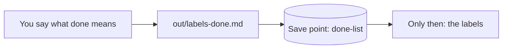

# Write the done list

## The problem

Next, Claude makes 12 shelf labels. Before it starts, you decide what a good label looks like. If you look at the labels first, you judge them by what Claude made, not by what Jess needs.

People lean toward what a tool shows them. In one Anthropic study, 50 trained analysts worked with an agent. A coin flip set which way the agent leaned. The analysts went with its lean 86% of the time ([Anthropic, agents and judgment calls](https://www.anthropic.com/research/agents-judgment-calls)). A list you write first keeps your own judgment.



## Your challenge

Stay in Manual mode. Make no labels yet. Paste this:

```text
Before you make any shelf label, write out/labels-done.md:
a list of checks a person can tick, each line starting with "- [ ]".
At least four checks. One must say the label names sesame when the
recipe has sesame. One must say a person signs the "Checked by:" line.
Do not make any label yet.
```

Read the list. Would it catch a wrong label? For example, the Multigrain Loaf recipe now has sesame seeds. But its old label in `labels/` says only "gluten, soya". One check must catch that.

Then make a save point, so the list is on record before any label:

```text
Make a save point called done-list.
```

## Done when

- `out/labels-done.md` has 4 or more checkbox lines.
- One names sesame. One names the sign-off by a person.
- The done list is in a save point, and no label is in that save point.

```bash
bun run verify write-the-done-list
```

Expect: `Done. All 7 rules pass.`

## If you get stuck

| What you see                                                       | Try this                                                              |
| ------------------------------------------------------------------ | --------------------------------------------------------------------- |
| `FAIL the done list was in a save point before any label was made` | Ask Claude for a save point called done-list. Do it before any label. |
| `FAIL one check names sesame`                                      | Ask Claude to add a check about sesame on the Multigrain Loaf.        |
| `FAIL it has 4 or more checkbox lines`                             | Ask Claude to start each check with `- [ ]`.                          |

## Words you will use

- **Done list**: what a finished piece of work must have. You write it before the work.
- **Checkbox**: a line that starts with `- [ ]`. It becomes `- [x]` when it is ticked.
- **Allergen**: a food that makes some people ill, like sesame or milk.
