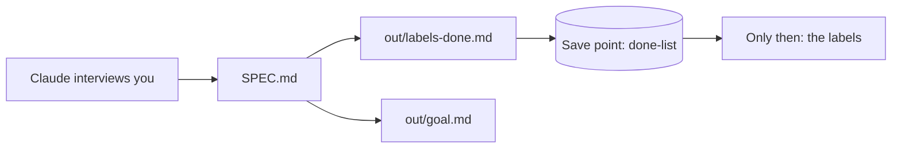

# Write the done list

## The problem

Claude is about to make 12 shelf labels. Judge them after, and you judge by what Claude made. In an Anthropic study, 50 analysts followed an agent's lean 86% of the time ([Anthropic](https://www.anthropic.com/research/agents-judgment-calls)). Write "done" first.



## Watch it done

The Multigrain Loaf recipe has sesame seeds. Its old label says:

```text
Contains: gluten, soya
```

Your done list gets a line that catches it:

```text
- [ ] The Multigrain Loaf label names sesame, because the recipe now has sesame seeds.
```

A **spec** is a short file that says what you want and when to stop. Claude writes it after it asks you questions.

## Your turn

Stay in Manual mode. Make no labels yet.

1. Ask Claude to interview you.

   ```text
   Interview me about the 12 shelf labels, one question at a time. Use
   recipes/multigrain-loaf.md and labels/multigrain-loaf.md. Then write
   SPEC.md with ## Goal, ## Stop condition and ## Questions and answers,
   each question as "Q:" and each answer as "A:".
   ```

   Expect: Claude asks you questions, then offers to write `SPEC.md`. Say yes.

2. Ask for the done list, made from the spec.

   ```text
   From SPEC.md, write out/labels-done.md: four or more lines that start
   with "- [ ]". One names sesame. One says a person signs.
   ```

   Expect: a file with checkbox lines. No label exists yet.

3. Ask for the goal line. A `/goal` line tells Claude when it may stop.

   ```text
   Write out/goal.md: one line that starts with /goal, says to make the
   12 labels, then "until" and the stop condition from SPEC.md.
   ```

   Expect: one line that starts with `/goal`.

4. Make the save point, so the list is on record before any label.

   ```text
   Make a save point called done-list.
   ```

   Expect: Claude shows the git commands. Read them, then say yes.

## Do it on your work

Pick a job of your own with a clear end, such as a monthly report. Let Claude interview you, then keep a spec, a done list and a goal line beside it. Good is a stop condition a stranger could test: a count, a file, a name.

## Done when

- `SPEC.md` has a goal, a stop condition and two questions with answers.
- `out/labels-done.md` has four checkboxes, one on sesame and one on signing.
- `out/goal.md` has a `/goal` line with "until" in it.
- The done list is in a save point, and no label is.

Ask Claude: "Please check my work for write-the-done-list. Run it and tell me what it printed. Do not change anything to make it pass."

```bash
bun run verify write-the-done-list
```

Expect: `Done. All 11 rules pass.`

## Solution

The finished files are in `solution/`.

## If you get stuck

| What you see                                       | Try this                                       |
| -------------------------------------------------- | ---------------------------------------------- |
| `FAIL the done list was in a save point`           | Ask for a save point called done-list first.   |
| `FAIL out/goal.md has a /goal line`                | The line must start with /goal and say "until". |

## Words you will use

- **Done list**: what a finished piece of work must have.
- **Stop condition**: what must be true before Claude may stop.
- **Checkbox**: a line that starts with `- [ ]`. Ticked, it is `- [x]`.
