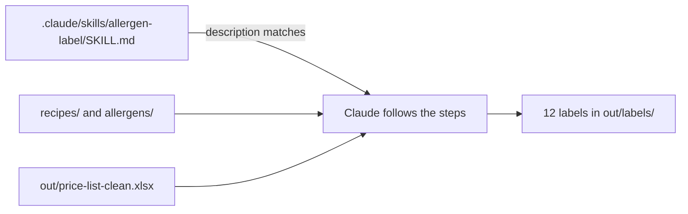

# Build the label skill

## The problem

Ask Claude for a label three times, and you get three shapes. One says "Allergens", one says "Contains", one forgets the price. Jess wants every label the same, every time.

A **skill** is a method you teach Claude once. It lives in a file called `SKILL.md`. Claude reads only its description until a job matches. Then it reads the steps and follows them. You can also start it by name: `/allergen-label`.



## Your challenge

Stay in Manual mode. Paste this:

```text
Make a skill at .claude/skills/allergen-label/SKILL.md that makes a shelf
label for one product. Give it a name and a description that says it is
for labels. Add a "## Steps" part: read the recipe, find each allergen
with allergens/allergen-list.csv, take the shop price from
out/price-list-clean.xlsx, and write out/labels/<recipe file name>
with the lines Price:, Contains: and an empty "Checked by:".
Add a "## Never" part: never fill in "Checked by:", and never copy
the old label in labels/.
```

Read the skill before you say yes. Then type `/allergen-label` and run it for every recipe. For example:

```text
/allergen-label Use it for all 12 recipes.
```

Open `out/labels/multigrain-loaf.md`. It must say sesame. Check it against your done list.

## Done when

- The skill has a name, a description that says label, and Steps and Never parts.
- There is a label for each of the 12 recipes in `out/labels/`.
- Each label lists exactly the allergens in its recipe.
- Each price comes from the clean price list.

To check, ask Claude:

```text
Please check my work for build-the-label-skill. Run bun run verify build-the-label-skill and tell me what it printed. Do not change anything to make it pass.
```

It runs:

```bash
bun run verify build-the-label-skill
```

Expect: `Done. All 8 rules pass.`


## If you get stuck

| What you see                                                     | Try this                                                             |
| ---------------------------------------------------------------- | -------------------------------------------------------------------- |
| `FAIL each label lists exactly the allergens in its recipe`      | Claude copied an old label. The recipe is the truth.                 |
| `FAIL each label shows the shop price from the clean price list` | Claude used the menu. The Sourdough Loaf is £4.20 on the clean list. |
| `/allergen-label` is not in the list                             | Start a new chat, so Claude Code finds the new skill.                |

This course teaches a way of working, not food law. A person always signs the label.

## Words you will use

- **Skill**: a method Claude follows the same way every time, kept in `SKILL.md`.
- **Description**: one line that tells Claude when to use the skill.
- **Frontmatter**: the lines between the two `---` lines at the top of the skill.
