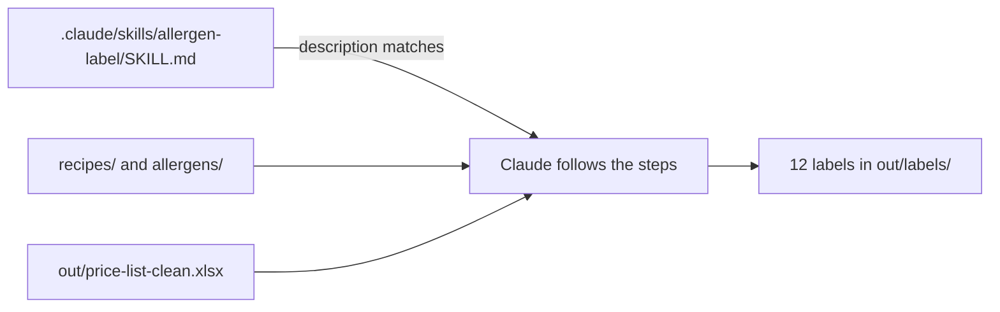
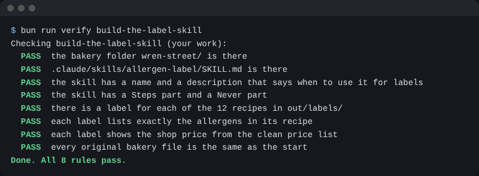

# Build the label skill

## The problem

Ask Claude for a label three times and you get three shapes. One says "Allergens", one says "Contains", one forgets the price. Jess wants all 12 labels the same. A **skill** is a method you teach Claude once, in a file called `SKILL.md`. Claude reads the steps only when a job matches.



## Watch it done

For example, here is the recipe `recipes/multigrain-loaf.md`, and the label the skill makes from it:

```text
Ingredients: wheat flour, oats, soya flour, sesame seeds, water, yeast, salt

# Multigrain Loaf
Price: £4.00
Contains: gluten, sesame, soya
Checked by:
```

The old label said only "gluten, soya". The skill reads the recipe, so it finds the sesame.

## Your turn

Stay in Manual mode.

1. Ask Claude to write the skill.

   ```text
   Make a skill at .claude/skills/allergen-label/SKILL.md that makes a shelf
   label for one product. Give it a name and a description that says it is
   for labels. Add a "## Steps" part: read the recipe, find each allergen
   with allergens/allergen-list.csv, take the shop price from
   out/price-list-clean.xlsx, and write out/labels/<recipe file name>
   with the lines Price:, Contains: and an empty "Checked by:".
   Add a "## Never" part: never fill in "Checked by:", and never copy
   the old label in labels/.
   ```

   Expect: Claude shows the new `SKILL.md`. Read it, then say yes.

2. Run the skill for every recipe.

   ```text
   /allergen-label Use it for all 12 recipes.
   ```

   Expect: 12 files in `out/labels/`. If `/allergen-label` is not found, start a new chat.

3. Open `out/labels/multigrain-loaf.md`.

   Expect: the Contains line names sesame.

## Do it on your work

Pick a small job you do the same way each time, like a weekly note. Ask Claude to write its steps into a skill, with a Never part for what must not happen. Good is a skill you can read in one minute that gives the same shape every run.

## Done when

- The skill has a name, a description that says label, and Steps and Never parts.
- There is a label for each of the 12 recipes in `out/labels/`.
- Each label lists exactly the allergens in its recipe, with the price from the clean list.

Ask Claude: "Please check my work for build-the-label-skill. Run it and tell me what it printed. Do not change anything to make it pass."

```bash
bun run verify build-the-label-skill
```

Expect: `Done. All 8 rules pass.`



## Solution

The finished skill and 12 labels are in `solution/`.

## If you get stuck

| What you see                                                     | Try this                                                             |
| ---------------------------------------------------------------- | -------------------------------------------------------------------- |
| `FAIL each label lists exactly the allergens in its recipe`      | Claude copied an old label. The recipe is the truth.                 |
| `FAIL each label shows the shop price from the clean price list` | Claude used the menu. The Sourdough Loaf is £4.20 on the clean list. |

This course teaches a way of working, not food law. A person always signs the label.

## Words you will use

- **Skill**: a method Claude follows the same way every time, kept in `SKILL.md`.
- **Description**: one line that tells Claude when to use the skill.
