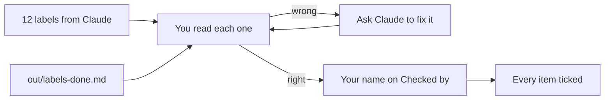

# Sign off the labels

## The problem

A label with a missing allergen can make a customer ill. So no label goes on the shelf until a person has read it and signed it. Claude makes the labels. You sign them.

Good tools still miss some. An insurance firm, DXC, built a Claude app for one claims job. It "was 80% right on the first pass". Claims experts checked the rest ([DXC](https://claude.com/customers/dxc)).



## Your challenge

Open each label in `out/labels/`. Check it against the items in `out/labels-done.md` and against its recipe.

For example, open `out/labels/brownie.md`. The recipe has wheat flour, butter, eggs, walnuts and soya lecithin. So the label must say gluten, milk, eggs, nuts and soya.

If a label is wrong, ask Claude to fix it from the recipe. When every label is right, paste this, with your own name:

```text
I have read all 12 labels in out/labels/. They are right.
Write "Checked by: <your name>" on each one.
Then tick every item in out/labels-done.md: change [ ] to [x].
```

Claude never signs on its own. You read, then you tell Claude your name.

## Done when

- Every label has a name after "Checked by:".
- No label is signed by Claude.
- Every item in `out/labels-done.md` is ticked.

```bash
bun run verify sign-off-the-labels
```

Expect: `Done. All 6 rules pass.`

## If you get stuck

| What you see                                      | Try this                                                |
| ------------------------------------------------- | ------------------------------------------------------- |
| `FAIL no label is signed by Claude`               | Tell Claude to put your name, not its own.              |
| `FAIL every label has a name after "Checked by:"` | One label was missed. Ask Claude which one has no name. |
| `FAIL every item in out/labels-done.md is ticked` | Check the last items, then ask Claude to tick them.     |

This course teaches a way of working, not food law.

## Words you will use

- **Sign off**: a person says "I checked this" and puts their name on it.
- **Tick**: mark a checkbox as done: `- [x]`.
