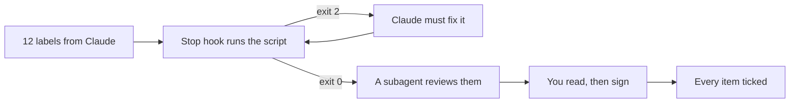

# Sign off the labels

## The problem

A label with a missing allergen can make a customer ill. Even good tools miss some: an insurance firm, DXC, built a Claude app for one claims job. It "was 80% right on the first pass". Claims experts checked the rest ([DXC](https://claude.com/customers/dxc)). Claude makes the labels. A gate checks them, and you sign.



## Watch it done

For example, the recipe `recipes/brownie.md` has wheat flour, butter, eggs, walnuts and soya lecithin. Its label must say:

```text
Contains: gluten, milk, eggs, nuts, soya
Checked by: Jess, the owner
```

A **hook** is a small script that Claude Code runs at a set moment. A **Stop hook** runs when Claude tries to stop. If the script exits with 2, Claude may not stop, and it reads what the script printed.

## Your turn

1. Ask Claude for the gate.

   ```text
   Write .claude/hooks/check-labels.sh: it exits 2 and prints the problem
   unless out/labels/ has 12 files and each has a Price: and a Contains: line.
   Then add a Stop hook for it to .claude/settings.json.
   ```

   Expect: a script and a settings file with a `Stop` hook. Read both, then say yes.

2. Ask for a review by a **subagent**, a helper Claude that works on its own and reports back.

   ```text
   Use a subagent to run /code-review on out/labels/. Do not change any
   label. Save what it found in out/review.md under "## Found", one dash
   per finding. Say in the file that /code-review ran in a subagent.
   ```

   Expect: a file `out/review.md` with a Found part.

3. Read each label against `out/labels-done.md` and its recipe. Then sign.

   ```text
   I have read all 12 labels. They are right. Write "Checked by: <your name>"
   on each one, then tick every item in out/labels-done.md.
   ```

   Expect: your name on all 12 labels, and `[x]` on every item.

## Do it on your work

Pick work Claude repeats for you. Add a script that exits 2 when the output is wrong, and a Stop hook that runs it. Good is a gate that tests one thing you can name.

## Done when

- `.claude/settings.json` has a Stop hook, and its script can exit 2.
- `out/review.md` says `/code-review` ran in a subagent and lists what it found.
- Every label has a person's name, never Claude's.
- Every item in `out/labels-done.md` is ticked.

Ask Claude: "Please check my work for sign-off-the-labels. Run it and tell me what it printed. Do not change anything to make it pass."

```bash
bun run verify sign-off-the-labels
```

Expect: `Done. All 10 rules pass.`

## Solution

The finished files are in `solution/`.

## If you get stuck

| What you see                        | Try this                                   |
| ----------------------------------- | ------------------------------------------ |
| `FAIL no label is signed by Claude` | Tell Claude to put your name, not its own. |

## Words you will use

- **Sign off**: a person says "I checked this" and puts their name on it.
- **Exit code**: the number a script ends with. 0 means fine. 2 means stop.
