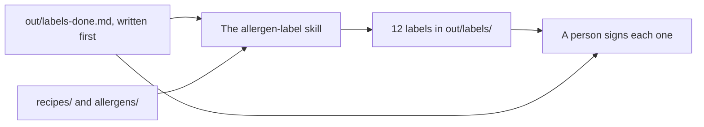

# Do it the same way every time

This part moves you toward the course goal: Claude does a job the same way every time, and a person signs off before it counts.

## The problem

Ask Claude for a label three times, and you get three shapes. And a label can be wrong. The Multigrain Loaf now has sesame on top, but its label does not say so.

Even good tools miss some. An insurance firm, DXC, built a Claude app for one claims job. It "was 80% right on the first pass". Claims experts checked the rest ([DXC](https://claude.com/customers/dxc)).

In this part, you tell Claude what "done" means, and it saves that before it starts. Then you teach Claude the method once, as a skill. Then a person signs each label.

For example, one line on the done list says: "The label names sesame when the recipe has sesame." The Multigrain Loaf label must pass that line.



## The steps

| Step                                                                | Minutes | What you make                                          | What the check reads                                                                |
| ------------------------------------------------------------------- | ------- | ------------------------------------------------------ | ----------------------------------------------------------------------------------- |
| [write-the-done-list](01-write-the-done-list/problem/README.md)     | 10      | `out/labels-done.md` and a save point                  | 4 or more checks, sesame named, saved before any label                              |
| [build-the-label-skill](02-build-the-label-skill/problem/README.md) | 25      | `.claude/skills/allergen-label/SKILL.md` and 12 labels | The skill parses; each label lists every allergen in its recipe and the right price |
| [sign-off-the-labels](03-sign-off-the-labels/problem/README.md)     | 10      | A name on every label                                  | Every label signed by a person; every done-list item ticked                         |

This course teaches a way of working, not food law. A person always signs the label.

## Walkthrough

Open the `wren-street` folder in Claude Code. Stay in Manual mode. You need the clean price list from the first part and the save points from the last part.

First, ask Claude for the done list, and read it. Then ask for a save point called `done-list`, before any label exists.

```bash
bun run verify write-the-done-list
```

Expect: `Done. All 7 rules pass.`

Next, ask Claude to write the `allergen-label` skill. Read it, then type `/allergen-label` and run it for all 12 recipes. Check the Multigrain Loaf label for sesame.

```bash
bun run verify build-the-label-skill
```

Expect: `Done. All 8 rules pass.`

Last, read each label against the done list. Then tell Claude your name for the "Checked by:" line, and ask it to tick the done list.

```bash
bun run verify sign-off-the-labels
```

Expect: `Done. All 6 rules pass.`

To check the whole part at once:

```bash
bun run verify part repeat-the-work
```

Expect: `Part repeat-the-work is done: 3/3 steps pass.`

## Hand it in

Hand in `out/labels-done.md`, `.claude/skills/allergen-label/SKILL.md` and the 12 labels in `out/labels/`. A grader answers each question yes or no:

1. Does `bun run verify write-the-done-list` pass, with the done list saved before any label?
2. Does `bun run verify build-the-label-skill` pass?
3. Does the Multigrain Loaf label name sesame?
4. Does every label carry a person's name, and does `bun run verify sign-off-the-labels` pass?

Go further: ask Claude to make three new recipes in `out/recipes-hard/`, with allergens hidden in brackets, like "dark chocolate (cocoa, soya lecithin)". Run the skill on them. Write in `out/labels-done.md` which check caught a missed allergen.

## FINISHED

You now have a done list you wrote first, a skill that makes every label the same way, and 12 labels a person signed. The skill is a file, so it works the same next time, and for the next person.

The next part is [Connect it and let it run](../05-connect-and-schedule/README.md). There Claude reads the till through a connector, and a skill writes the Monday report on a timer.
