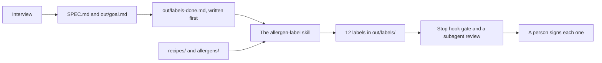

# Do it the same way every time

## After this part you can

Tell Claude what "done" means first, teach it a method once, and gate its work so a person signs before it counts.

## You leave with

A spec file, a done list and a goal line. An `allergen-label` skill with 12 labels. A Stop hook gate, a review note, and a name on every label.

## The problem

For example, ask Claude for a label three times and you get three shapes. A label can also be wrong. The Multigrain Loaf now has sesame on top, but its label does not say so. Even good tools miss some. An insurance firm, DXC, built a Claude app for one claims job. It "was 80% right on the first pass". Claims experts checked the rest ([DXC](https://claude.com/customers/dxc)). So you write down what done means first. Then you teach the method as a skill. At the end, a person signs.



## Steps

| Step                                                                | What you make                                                   | What the check reads                                                        |
| ------------------------------------------------------------------- | --------------------------------------------------------------- | --------------------------------------------------------------------------- |
| [write-the-done-list](01-write-the-done-list/problem/README.md)     | `SPEC.md`, `out/labels-done.md`, `out/goal.md` and a save point | A goal, a stop condition and questions; a `/goal` line; saved before labels |
| [build-the-label-skill](02-build-the-label-skill/problem/README.md) | `.claude/skills/allergen-label/SKILL.md` and 12 labels          | The skill parses; each label lists every allergen and the right price       |
| [sign-off-the-labels](03-sign-off-the-labels/problem/README.md)     | A Stop hook, `out/review.md` and a name on every label          | A Stop hook that can block; a review note; every label signed and ticked    |

This course teaches a way of working, not food law. A person always signs the label.

## Walkthrough

Open the `wren-street` folder in Claude Code. Stay in Manual mode. You need the clean price list from the first part and the save points from the last part.

To check, ask Claude: "Please check my work for the step name. Run it and tell me what it printed. Do not change anything to make it pass." The [ways of working](../../00-orientation/ways-of-working.md) page lists every mode and command used here.

First, let Claude interview you and write the spec, the done list and the goal line. Then ask for a save point called `done-list`, before any label exists.

```bash
bun run verify write-the-done-list
```

Expect: `Done. All 11 rules pass.`

Next, ask Claude to write the `allergen-label` skill. Type `/allergen-label` and run it for all 12 recipes.

```bash
bun run verify build-the-label-skill
```

Expect: `Done. All 8 rules pass.`

Last, add the Stop hook gate, run the review in a subagent, read each label, and give Claude your name for the "Checked by:" line.

```bash
bun run verify sign-off-the-labels
```

Expect: `Done. All 10 rules pass.`

To check the whole part at once:

```bash
bun run verify part repeat-the-work
```

Expect: `Part repeat-the-work is done: 3/3 steps pass.`

## Watch and read

| Kind  | Title                                                      | Author                       | Why                                                                                               | Link                                                                        |
| ----- | ---------------------------------------------------------- | ---------------------------- | ------------------------------------------------------------------------------------------------- | --------------------------------------------------------------------------- |
| video | Claude Code Advanced Patterns: Subagents, MCP, and Scaling | Anthropic Applied AI team    | Shows subagents and hooks guarding multi-step work. A free form is needed to watch.               | https://claude.com/resources/webinars/claude-code-advanced-patterns         |
| video | Claude Code Best Practices: Power User Insights            | Anthropic, with two founders | Live demos of hooks and subagents from teams that use them daily. A free form is needed to watch. | https://claude.com/resources/webinars/claude-code-best-practices-lightspeed |
| read  | Best practices for Claude Code                             | Anthropic docs               | Says to give Claude a way to check its work, and to let it interview you.                         | https://code.claude.com/docs/en/best-practices                              |
| read  | Automate workflows with hooks                              | Anthropic docs               | The Stop hook and exit code 2, step by step.                                                      | https://code.claude.com/docs/en/hooks-guide                                 |
| read  | Extend Claude with skills                                  | Anthropic docs               | How a skill is written and when Claude picks it.                                                  | https://code.claude.com/docs/en/skills                                      |
| read  | Building effective agents                                  | Anthropic engineering blog   | Why a person checks the work, and when a loop with a check beats a guess.                         | https://www.anthropic.com/engineering/building-effective-agents             |

## Project

Pick one job on your own work that you ask Claude for again and again. Do four things. Let Claude interview you and write a `SPEC.md` with a stop condition. Write the done list before the work. Put the method in a skill. Add a Stop hook that exits 2 when the output is wrong. Then read the result and sign it yourself.

Hand in `SPEC.md`, the skill, the settings file and your signed output. A grader answers yes or no:

1. Does `SPEC.md` have a goal, a stop condition and questions with answers?
2. Was the done list saved before the work?
3. Does the Stop hook run a script that can exit 2?
4. Does the output carry a person's name?

## FINISHED

You now have a done list you wrote first. A skill makes every label the same way. A gate stops bad work. A person signed all 12 labels.

The next part is [Connect it and let it run](../05-connect-and-schedule/README.md). There Claude reads the till through a connector, and a skill writes the Monday report on a timer.
