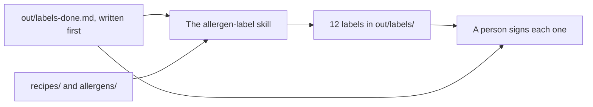

# Do it the same way every time

## The problem

Ask Claude for a label three times, and you get three shapes. And a label can be wrong. The Multigrain Loaf now has sesame on top, but its label does not say so.

Even good tools miss some. An insurance team found their Claude app "was 80% right on the first pass". People checked the rest ([DXC](https://claude.com/customers/dxc)).

In this part you write what "done" means before Claude starts. Then you teach Claude the method once, as a skill. Then a person signs each label.



## The steps

| Step                  | Minutes | What you make                                          | What the check reads                                                                |
| --------------------- | ------- | ------------------------------------------------------ | ----------------------------------------------------------------------------------- |
| write-the-done-list   | 10      | `out/labels-done.md`                                   | 4 or more checks, sesame named, made before any label                               |
| build-the-label-skill | 25      | `.claude/skills/allergen-label/SKILL.md` and 12 labels | The skill parses; each label lists every allergen in its recipe and the right price |
| sign-off-the-labels   | 10      | A name on every label                                  | Every label signed; every done-list item ticked                                     |

This course teaches a way of working, not food law. A person always signs the label.

## Walkthrough

TODO(part session): one paragraph per step and its exact Expect line.

```bash
bun run verify part repeat-the-work
```

Expect: TODO(part session)
