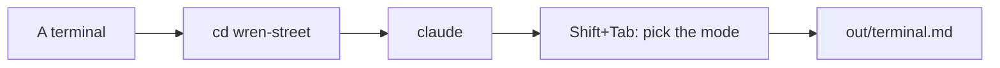

# Open the terminal

## The problem

So far you used Claude in the app. The next steps need the terminal too. You add the till with one command there. And a job that runs alone needs no clicks.

The terminal is a window where you type, not click. Claude Code in the terminal is the same Claude, with the same rules and the same folder. Only the look is new.



## Your challenge

Start Claude Code in the bakery folder. Find Plan mode with the keys, then go back to Manual mode.

1. Open a terminal. On a Mac, open the **Terminal** app. On Windows, open **PowerShell**. You do not need to run it as Administrator.
2. Go to the course folder. Then go into the bakery:

```bash
cd wren-street
```

Expect: no output. The next line starts in `wren-street`.

3. See which Claude Code you have:

```bash
claude --version
```

Expect: `2.1.314 (Claude Code)` or a bigger number.

4. Start Claude Code:

```bash
claude
```

Expect: Claude asks if you trust the files in this folder. Press the down arrow to pick **Yes, I trust this folder**, then press Enter. The first choice is **No, exit**.

5. Press **Shift+Tab** a few times. Watch the line under the box where you type. That line is the status bar. Stop when it says `plan mode on`. Copy the words you see.
6. Press **Shift+Tab** again until the status bar says `manual mode on`. Older versions of Claude Code show no mode at all; that is Manual mode too. In Manual mode, Claude asks you before each change.
7. Paste this, with your own words in the brackets:

```text
Make out/terminal.md with three headings.
"## Version": [what claude --version printed]
"## Status bar in Plan mode": [the words you copied]
"## Mode I work in": Manual
```

Claude shows the file and asks first. Read it, then say yes. Type `/exit` to leave Claude.

For example, in Plan mode the status bar says `⏸ plan mode on (shift+tab to cycle)`. In Plan mode, Claude reads and plans, but it changes nothing.

## Done when

- `out/terminal.md` has a version that is 2.1.314 or newer.
- It has the words the status bar showed in Plan mode.
- It says you work in Manual mode.
- No original file has changed.

```bash
bun run verify open-the-terminal
```

Expect: `Done. All 7 rules pass.`


## If you get stuck

| What you see                               | Try this                                                             |
| ------------------------------------------ | -------------------------------------------------------------------- |
| `claude: command not found`                | Install Claude Code from the start page. Then open a new terminal.   |
| `FAIL  the version is 2.1.314 or newer`    | Run `claude update`. Then write the new number.                      |
| `FAIL  it says what the status bar showed` | Press Shift+Tab until you see `plan mode on`. Copy those words.      |
| `FAIL  it names Manual mode`               | Write Manual under the heading, not Auto.                            |
| `error: Script not found "verify"`         | Run `cd wren-street` first, or run the check from the course folder. |

## Words you will use

- **Terminal**: a window where you type commands instead of clicking.
- **Status bar**: the line under the box where you type. It shows the mode.
- **Plan mode**: Claude reads and makes a plan, but changes no file.
