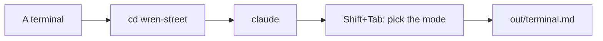
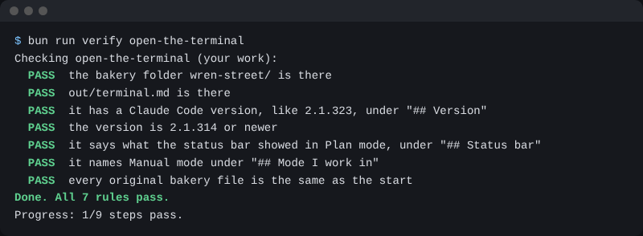

# Open the terminal

## The problem

The next steps need the terminal, a window where you type instead of click. One typed line adds the till, and a job that runs alone needs no clicks. Claude in the terminal is the same Claude, with the same rules and folder.



## Watch it done

The status bar is the line under the box where you type. Shift+Tab steps through the modes. For example, in Plan mode it reads:

```text
⏸ plan mode on (shift+tab to cycle)
```



## Your turn

1. Open a terminal. On a Mac, open the Terminal app. On Windows, open PowerShell. You do not need Administrator.
2. Go into the bakery:

```bash
cd wren-street
```

Expect: no output.

3. Ask Claude Code for its version:

```bash
claude --version
```

Expect: a version number, then the words Claude Code. If the check later says it is too old, run `claude update`.

4. Start Claude Code:

```bash
claude
```

Expect: Claude asks if you trust this folder. Press the down arrow to pick the Yes choice, then Enter. The first choice is No, so do not just press Enter.

5. Press Shift+Tab until the status bar shows Plan mode. Copy those words.
6. Press Shift+Tab until the status bar shows Manual mode, or no mode at all. In Manual mode, Claude asks before each change.
7. Paste this, with your own words in the brackets:

```text
Make out/terminal.md with three headings.
"## Version": [what claude --version printed]
"## Status bar in Plan mode": [the words you copied]
"## Mode I work in": Manual
```

Expect: Claude shows the file and asks first. Read it, say yes, then type `/exit`.

## Do it on your work

Do the same in your own project folder. Good looks like this: you can name the mode from the status bar, and you know Plan mode will not change a file.

## Done when

- `out/terminal.md` has a version that is new enough.
- It has the words the status bar showed in Plan mode.
- It says you work in Manual mode.
- No original file has changed.

Ask Claude to check:

```text
Please check my work for open-the-terminal. Run bun run verify open-the-terminal and tell me what it printed. Do not change anything to make it pass.
```

It runs this:

```bash
bun run verify open-the-terminal
```

Expect: `Done. All 7 rules pass.`

## Solution

The finished note is `solution/out/terminal.md`. The prompts that made it are in `solution/prompts.md`.

## If you get stuck

| What you see                               | Try this                                                             |
| ------------------------------------------ | -------------------------------------------------------------------- |
| `claude: command not found`                | Install Claude Code from the start page. Then open a new terminal.   |
| `FAIL  the version is ... or newer`        | Run `claude update`. Then write the new number.                      |
| `FAIL  it says what the status bar showed` | Press Shift+Tab until the bar shows Plan mode. Copy those words.     |
| `FAIL  it names Manual mode`               | Write Manual under the heading, not Auto.                            |

## Words you will use

- **Terminal**: a window where you type commands instead of clicking.
- **Status bar**: the line under the box where you type. It shows the mode.
- **Plan mode**: Claude makes a plan but changes no file.
