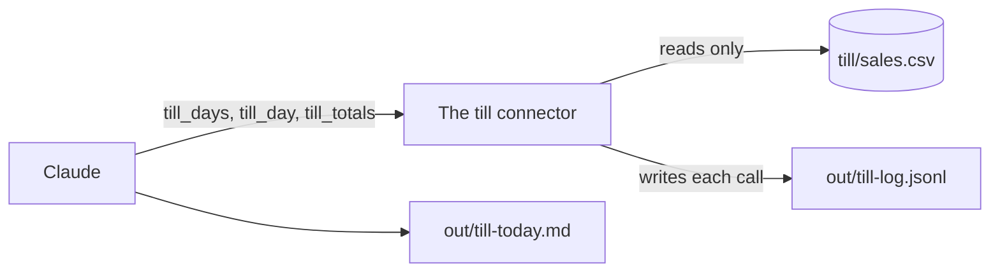

# Connect the till

## The problem

The Monday report needs the till. The till is the record of what really sold. In a real shop, the till is its own system, not a file Claude can edit.

A connector is a safe door to another system. Claude can ask the till questions. The till only answers. It cannot change a sale. The kind of connector Claude Code uses is called an MCP server.



## Your challenge

Add the till as a connector. Then ask Claude what the shop took on its last open day.

1. In the terminal, in `wren-street`, type this one line:

```bash
claude mcp add till --scope project -- bun ../parts/05-connect-and-schedule/till-server.ts
```

Expect: `Added stdio MCP server till with command: bun ../parts/05-connect-and-schedule/till-server.ts to project config`

This makes the file `.mcp.json`. It tells Claude Code how to start the till connector. `--scope project` keeps it with this folder.

2. Start Claude Code:

```bash
claude
```

Expect: Claude Code says `New MCP server found in this project: till`. Press the up arrow to pick **Use this MCP server**, then press Enter. The marked choice is **Continue without using this MCP server**, so do not just press Enter.

3. Type `/mcp` and press Enter. You see `✔ till   3 tools` in the list. The tick means it is connected. Press Esc.
4. Paste this:

```text
Use the till connector, not the file. Find the last day the shop
was open. Then get the takings for that day. Write out/till-today.md
with the day as YYYY-MM-DD and the takings in pounds.
```

5. Claude asks before it uses each till tool. Read the tool name. It starts with `till`. Say yes. Then Claude asks to write the file. Read it and say yes.

For example, Claude first calls `till_days`. The till answers with every day the shop was open. Then Claude calls `till_day` for the last one. The till answers with each product, what sold, and the total.

## Done when

- `.mcp.json` has a connector called `till`.
- `out/till-today.md` names a day the till has, and its takings match the till.
- The till's log shows Claude asked the connector for that day.
- No original file has changed.

```bash
bun run verify connect-the-till
```

Expect: `Done. All 7 rules pass.`


## If you get stuck

| What you see                                | Try this                                                              |
| ------------------------------------------- | --------------------------------------------------------------------- |
| `/mcp` shows no `till`                      | Type `/exit`, then `claude` again. Pick **Use this MCP server**.      |
| `till` shows failed                         | Run `bun --version`. The connector needs Bun.                         |
| `FAIL  the takings it gives match the till` | Ask for one day, not the whole till.                                  |
| `FAIL  Claude asked the till connector`     | The connector was off, so Claude read the file. Turn it on in `/mcp`. |

## Words you will use

- **Connector**: a safe door that lets Claude ask another system for facts.
- **MCP server**: the small program behind a connector. MCP is the shared way Claude talks to it.
- **Read only**: you can look, but you cannot change anything.
