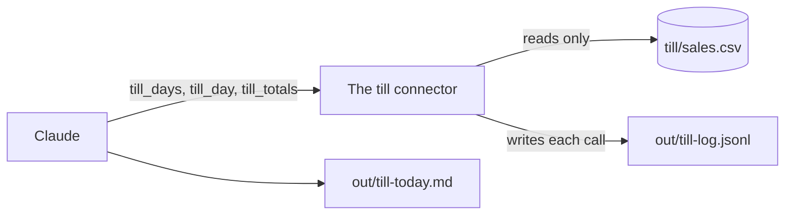
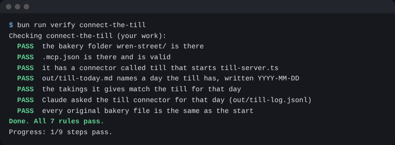

# Connect the till

## The problem

The Monday report needs the till, the record of what really sold. In a real shop it is its own system, not a file Claude can edit. The whole record holds £13,609.80, but the last open day took £474.35. A guess mixes them up. A connector lets Claude ask the till.



## Watch it done

A connector is a safe door to another system. The till answers questions and cannot change a sale. Claude Code calls this kind of door an MCP server. After you add it, Claude asks the till for the days, then for one day.

```text
- Day: 2026-11-01
- Takings: £474.35
```

## Your turn

1. In the terminal, in `wren-street`, type one line:

```bash
claude mcp add till --scope project -- bun ../parts/05-connect-and-schedule/till-server.ts
```

Expect: a line that says it added the server till to the project config. This makes `.mcp.json`.

2. Start Claude Code:

```bash
claude
```

Expect: Claude Code says it found a new MCP server called till. Pick the Use choice with the up arrow, then Enter. The marked choice says Continue without, so do not just press Enter.

3. Type `/mcp` and press Enter.

Expect: till is in the list with a tick and 3 tools. Press Esc.

4. Paste this:

```text
Use the till connector, not the file. Find the last day the shop
was open. Then get the takings for that day. Write out/till-today.md
with the day as YYYY-MM-DD and the takings in pounds.
```

Expect: Claude asks before each till tool. Read the tool name, which starts with till, and say yes. Then it asks to write the file. Say yes.

## Do it on your work

Pick one system you look up by hand. Add its connector. Good looks like this: Claude uses a tool from the connector, and the number matches the source.

## Done when

- `.mcp.json` has a connector called till.
- `out/till-today.md` names a day the till has, and its takings match the till.
- The till's log shows Claude asked the connector for that day.
- No original file has changed.

To check, ask Claude:

```text
Please check my work for connect-the-till. Run bun run verify connect-the-till and tell me what it printed. Do not change anything to make it pass.
```

It runs:

```bash
bun run verify connect-the-till
```

Expect: `Done. All 7 rules pass.`



## Solution

The after state is in `solution/`: `.mcp.json`, the note, and the log.

## If you get stuck

| What you see                                | Try this                                                              |
| ------------------------------------------- | --------------------------------------------------------------------- |
| `/mcp` shows no till                        | Type `/exit`, then `claude` again. Pick the Use choice.               |
| `FAIL  the takings it gives match the till` | Ask for one day, not the whole till.                                  |
| `FAIL  Claude asked the till connector`     | The connector was off, so Claude read the file. Turn it on in `/mcp`. |

## Words you will use

- **Connector**: a safe door that lets Claude ask another system for facts.
- **MCP server**: the small program behind a connector. MCP is the shared way Claude talks to it.
- **Read only**: you can look, but you cannot change anything.
