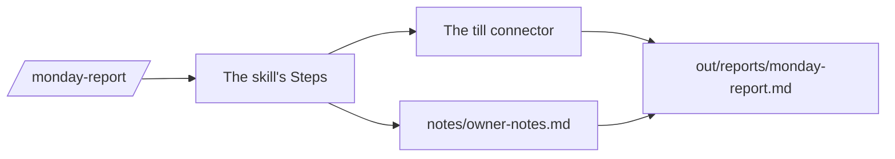
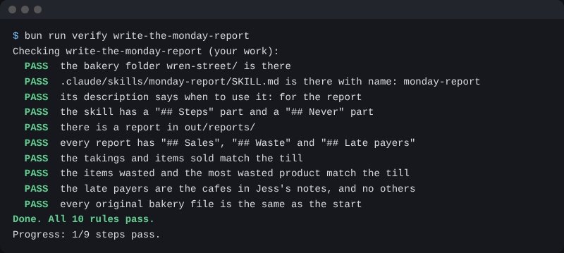

# Make the Monday skill

## The problem

Jess reads the Monday report before the shop opens. Today she adds it up with a pen. A number Claude works out in its head can be wrong and still sound sure. The report must come from the till, in the same shape each time. A skill does that.



## Watch it done

A skill is a saved set of steps Claude follows the same way each time. The report it makes has Sales, Waste and Late payers. For example, the cafes come from Jess's notes.

```text
## Late payers

- Kettle and Crumb
- Moss and Grain
```

## Your turn

1. Start `claude` in `wren-street`. Paste this:

```text
Make a skill at .claude/skills/monday-report/SKILL.md, named
monday-report. Its description says: use it when asked for the
Monday report. Steps: get the totals from the till connector. Read
notes/owner-notes.md for the cafes that pay late. Write
out/reports/monday-report.md: two short sentences, then "## Sales"
(takings and items sold), "## Waste" (items wasted and the most
wasted product), and "## Late payers" (one line per cafe).
Add "## Never": never guess a number, never change the till.
```

Expect: Claude shows the whole skill, with Steps and Never. Read it, then say yes.

2. Type `/exit`, then `claude` again. This loads the skill.
3. Type `/monday-report`.

Expect: Claude asks to use the till tools. Say yes. Then it asks to write the report. Read it first. The takings, items sold and wasted match the till.

## Do it on your work

Pick one report you write by hand each week. Ask Claude for a skill with Steps and a Never part, then run it with one word. Good looks like this: every number comes from the real record, and the skill says never to guess.

## Done when

- The skill has a name, a description that says report, and Steps and Never parts.
- The report has Sales, Waste and Late payers.
- Takings, items sold, items wasted and the most wasted product match the till.
- The late payers are the two cafes in Jess's notes.
- No original file has changed.

Ask Claude to check my work for make-the-monday-skill, and not to change anything to make it pass. It runs:

```bash
bun run verify make-the-monday-skill
```

Expect: `Done. All 10 rules pass.`



## Solution

The after state is in `solution/`: the skill file and the report it made.

## If you get stuck

| What you see                              | Try this                                                               |
| ----------------------------------------- | ---------------------------------------------------------------------- |
| `/monday-report` is not in the list       | Type `/exit`, then `claude` again. Check the file is named `SKILL.md`. |
| `FAIL  the takings and items sold match`  | Ask the skill to use the till connector, not a guess.                  |
| `FAIL  the late payers are the cafes`     | Ask the skill to read `notes/owner-notes.md`.                          |
| `FAIL  there is a report in out/reports/` | Check the skill writes to `out/reports/monday-report.md`.              |

## Words you will use

- **Skill**: a saved set of steps Claude follows the same way each time.
- **Description**: one line that tells Claude when to use the skill.
- **Takings**: the money the shop took from sales.
