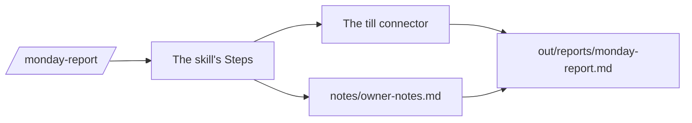

# Write the Monday report

## The problem

Jess reads the Monday report before the shop opens. Today she adds it up with a pen. A number Claude works out in its head can be wrong and still sound sure. The report must come from the till, in the same shape each time. A skill does that.



## Watch it done

A skill is a saved set of steps Claude follows the same way each time. The report it makes has Sales, Waste and Late payers. The cafes come from Jess's notes.

```text
## Late payers

- Kettle and Crumb
- Moss and Grain
```

## Your turn

1. Start `claude` in `wren-street`. Paste this:

```text
Make a skill at .claude/skills/monday-report/SKILL.md, named
monday-report. Its description says: use it when asked for the
Monday report. Steps: get the totals from the till connector. Read
notes/owner-notes.md for the cafes that pay late. Write
out/reports/monday-report.md: two short sentences, then "## Sales"
(takings and items sold), "## Waste" (items wasted and the most
wasted product), and "## Late payers" (one line per cafe).
Add "## Never": never guess a number, never change the till.
```

Expect: Claude shows the skill, with Steps and Never. Say yes.

2. Type `/exit`, `claude`, then `/monday-report`.

Expect: Claude asks to use the till tools. Say yes, then read the report.

3. Add a checker. A subagent is a helper with its own chat and only the tools you give it. Paste:

```text
Make a subagent at .claude/agents/numbers-checker.md with only the
tools Read, Grep and Glob. It checks a report against till/sales.csv.
Run it on out/reports/monday-report.md. Save its answer in
out/numbers-check.md as a dash list that ends with a verdict.
```

Expect: the checker can only read, and its note says the report matches.

4. Try it again in a worktree, a second copy of your folder on its own branch. Type `/exit`, then:

```bash
claude -w second-try
```

Expect: Claude starts in `.claude/worktrees/second-try`. Run `/monday-report`, then `/exit`.

5. Back in `wren-street`, paste:

```text
Make out/worktree.md. Under "## Worktree", write the worktree folder
or branch name I just used. Add one line on what I ran there.
```

Expect: the note names `.claude/worktrees/second-try` or the branch `worktree-second-try`.

## Do it on your work

Turn one report you write by hand into a skill with a Never part, plus a read-only checker. Good looks like this: one word runs it, and the checker names any number that differs.

## Done when

- The skill has a name, a report description, Steps and Never.
- The report has Sales, Waste and Late payers, and every number matches the till.
- The late payers are the two cafes in Jess's notes.
- The checker can only read, and its note says the report matches.
- `out/worktree.md` names a worktree folder or branch.
- No original file has changed.

Ask Claude to check my work for write-the-monday-report, and not to change anything. It runs:

```bash
bun run verify write-the-monday-report
```

Expect: `Done. All 13 rules pass.`


## Solution

The after state is in `solution/`: the skill, the checker, the report, and the two notes.

## Go further

- Run two worktrees at once, each with a different wording of the skill, and compare.

## If you get stuck

| What you see                              | Try this                                                               |
| ----------------------------------------- | ---------------------------------------------------------------------- |
| `/monday-report` is not listed            | Type `/exit`, then `claude` again. The file must be `SKILL.md`. |
| `FAIL  the takings and items sold match`  | Ask the skill to use the till connector, not a guess.           |
| `FAIL  the late payers are the cafes`     | Ask the skill to read `notes/owner-notes.md`.                   |
| `FAIL  out/worktree.md names`             | Run `claude -w second-try`, then write the folder or branch.    |
| `claude -w` says this is not a git folder | Do the save-point step first. A worktree needs git.             |

## Words you will use

- **Subagent**: a helper Claude starts for one job. It works in its own chat, with only the tools you give it.
- **Worktree**: a second copy of your folder on its own branch, made by `claude -w`.
