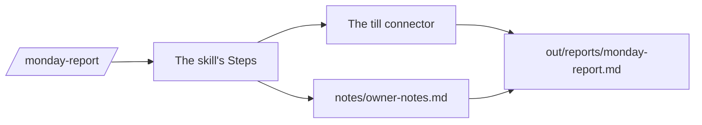

# Write the Monday report

## The problem

Jess reads the Monday report before the shop opens. It says what the shop took, what was thrown away, and which cafes pay late. Today she adds it up from the till with a pen.

Claude can write it. But a number Claude works out in its head can be wrong, and it looks just as sure. So the numbers must come from the till. And the report must have the same shape every time. A skill does both.



## Your challenge

Ask Claude to make a `monday-report` skill. Then run it once and check its numbers.

1. Start `claude` in `wren-street`. Paste this:

```text
Make a skill at .claude/skills/monday-report/SKILL.md, named
monday-report. Its description says: use it when asked for the
Monday report. Steps: get the totals from the till connector. Read
notes/owner-notes.md for the cafes that pay late. Write
out/reports/monday-report.md: two short sentences, then "## Sales"
(takings and items sold), "## Waste" (items wasted and the most
wasted product), and "## Late payers" (one line per cafe).
Add "## Never": never guess a number, never change the till.
```

2. Read the skill before you say yes. Check that it has Steps and Never.
3. Type `/exit`, then `claude` again, so Claude Code loads the new skill.
4. Type `/monday-report` and press Enter. Say yes to the till tools. Read the report before you say yes to the file.

For example, the report has a part like this. The cafes come from Jess's notes:

```text
## Late payers

- Kettle and Crumb
- Moss and Grain
```

## Done when

- The skill has `name: monday-report`, a description that says report, and Steps and Never parts.
- `out/reports/` has a report with Sales, Waste and Late payers.
- The takings, items sold, items wasted and most wasted product match the till.
- The late payers are the two cafes in Jess's notes.
- No original file has changed.

To check, ask Claude:

```text
Please check my work for write-the-monday-report. Run bun run verify write-the-monday-report and tell me what it printed. Do not change anything to make it pass.
```

It runs:

```bash
bun run verify write-the-monday-report
```

Expect: `Done. All 10 rules pass.`


## If you get stuck

| What you see                              | Try this                                                               |
| ----------------------------------------- | ---------------------------------------------------------------------- |
| `/monday-report` is not in the list       | Type `/exit`, then `claude` again. Check the file is named `SKILL.md`. |
| `FAIL  the takings and items sold match`  | Ask the skill to use the till connector, not a guess.                  |
| `FAIL  the late payers are the cafes`     | Ask the skill to read the Cafes part of `notes/owner-notes.md`.        |
| `FAIL  there is a report in out/reports/` | Check the skill writes to `out/reports/monday-report.md`.              |

## Words you will use

- **Skill**: a saved set of steps Claude follows the same way each time.
- **Description**: one line that tells Claude when to use the skill.
- **Takings**: the money the shop took from sales.
