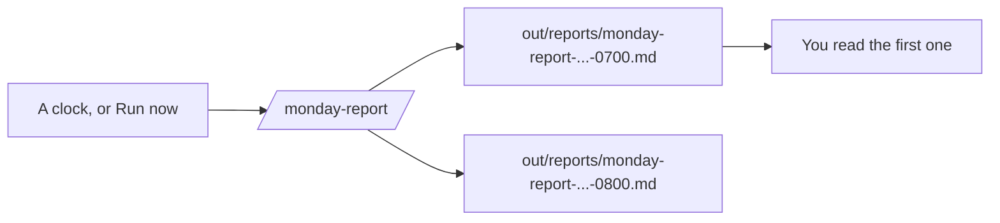
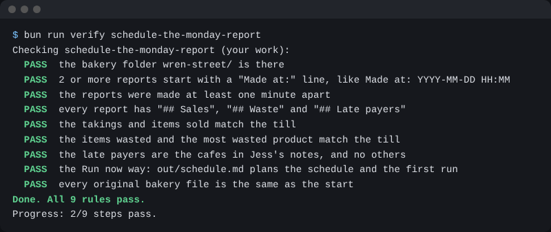

# Schedule the Monday report

## The problem

Jess wants the report waiting for her. A scheduled task can do that. It starts Claude on a clock, with nobody there.

Nobody is there to say no. So each run keeps its own file and says when it was made. And you read the first runs before you trust it. Anthropic's sales team did the same: "After enough manual checks confirmed Claude was getting it right, he removed the validation and lets it run" ([Anthropic](https://claude.com/resources/guides/deploying-claude-across-your-organization/how-anthropic-teams-use-cowork)).



## Your challenge

Make every run keep its own report. Then run the skill two times with no prompt from you.

1. Start `claude` in `wren-street`. Paste this:

```text
Change the monday-report skill. Each run saves a new file named
out/reports/monday-report-YYYY-MM-DD-HHMM.md, with the time from the
date command. Never write over an old report. Start each report
with the line "Made at: YYYY-MM-DD HH:MM".
```

2. Pick the way that works for you.

**Way 1: a scheduled task, in the desktop app.** In the Code tab, click **Scheduled**, then **New task**. Name it `monday-report`. For the instructions, write `Run the monday-report skill.` Turn on **Only on this computer** and pick the `wren-street` folder. Pick the **Hourly** trigger for this test. Click **Create**, then **Run now**, and say yes to each prompt. Keep the app open until the next run. Then pause the task.

**Way 2: Run now.** Use this if you have no scheduled tasks. Click **Run now** two times, a few minutes apart, or type `/monday-report` two times. Then paste this:

```text
Make out/schedule.md. Under "## Schedule", write the cron line I would
use, in numbers only. Under "## Why I read the first run", write one
sentence on why I read the first report before it runs alone.
```

For example, the cron line `0 7 * * 2` runs at 7 in the morning on the second day of the week. The app does not take day names like TUE, only numbers.

## Done when

- `out/reports/` has 2 or more reports with a `Made at:` line.
- The reports were made at least one minute apart, and every number matches the till.
- Way 1: they were made 55 or more minutes apart. Or way 2: `out/schedule.md` has a cron line of numbers and says why you read the first run.
- No original file has changed.

The check says which way passed.

```bash
bun run verify schedule-the-monday-report
```

Expect: `Done. All 9 rules pass.`



## If you get stuck

| What you see                                     | Try this                                                              |
| ------------------------------------------------ | --------------------------------------------------------------------- |
| No **Scheduled** button in the app               | Use way 2.                                                            |
| A run waits and does nothing                     | Open the run from the task's History. Say yes to the prompt there.    |
| `FAIL  2 or more reports start with`             | The skill wrote over the old file. Ask for a new file name each run.  |
| `FAIL  it ran on a schedule, or out/schedule.md` | Use numbers in the cron line, and start it with one number, like `0`. |

## Words you will use

- **Scheduled task**: a saved prompt that the app starts on a clock.
- **Run now**: a button that starts a scheduled task at once.
- **Cron line**: five numbers that say when a job runs: minute, hour, day of the month, month, day of the week. A star means any.
