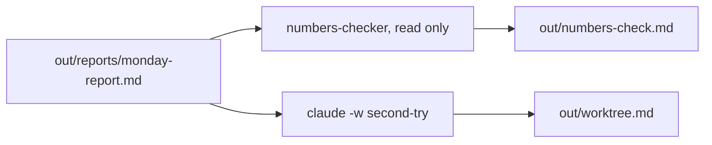
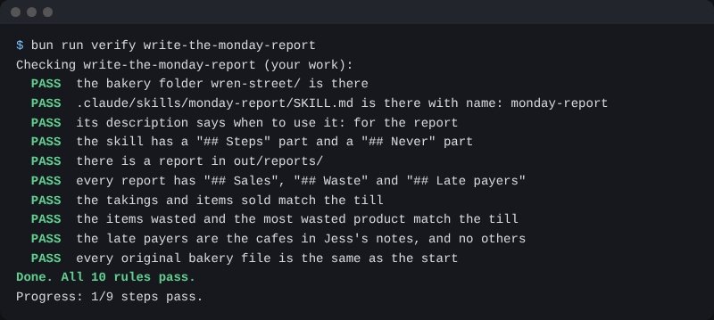

# Write the Monday report

## The problem

The skill writes a report, but nobody has checked it. One wrong number in Jess's Monday report costs her trust. A helper that can only read can check the numbers against the till. And a second try in its own copy of the folder cannot spoil the first.



## Watch it done

A subagent is a helper with its own chat and only the tools you give it. This one gets Read, Grep and Glob, so it cannot change a file. A worktree is a second copy of your folder on its own branch. For example, this is the note the checker leaves:

```text
- Takings: matches till/sales.csv.
- Items sold: matches till/sales.csv.
- Verdict: the report matches the till.
```

## Your turn

1. Start `claude` in `wren-street`. Paste this:

```text
Make a subagent at .claude/agents/numbers-checker.md with only the
tools Read, Grep and Glob. It checks a report against till/sales.csv.
Run it on out/reports/monday-report.md. Save its answer in
out/numbers-check.md as a dash list that ends with a verdict.
```

Expect: Claude shows the agent file. Its tools line has no Write. Say yes. The note ends with a verdict that the report matches.

2. Type `/exit`. Start a second try in a worktree:

```bash
claude -w second-try
```

Expect: Claude starts inside `.claude/worktrees/second-try`. Type `/monday-report`, say yes to the prompts, then type `/exit`.

3. Back in `wren-street`, start `claude` and paste:

```text
Make out/worktree.md. Under "## Worktree", write the worktree folder
and branch I just used. Add one line on what I ran there.
```

Expect: the note names `.claude/worktrees/second-try` or the branch `worktree-second-try`.

## Do it on your work

Add a read-only checker to your own report skill, then run one change in a worktree. Good looks like this: the checker names any number that differs, and your own folder is the same as before.

## Done when

- The checker can only read files, and its note says the report matches.
- `out/worktree.md` names a worktree folder or branch.
- The skill and report still pass, and no original file has changed.

Ask Claude to check my work for write-the-monday-report, and not to change anything to make it pass. It runs:

```bash
bun run verify write-the-monday-report
```

Expect: `Done. All 13 rules pass.`



## Solution

The after state is in `solution/`: the checker, its note, and `out/worktree.md`.

## Go further

- Run two worktrees at once, each with a different wording of the skill, and compare.

## If you get stuck

| What you see                              | Try this                                                     |
| ----------------------------------------- | ------------------------------------------------------------ |
| `FAIL  a subagent numbers-checker`        | Its tools line must be only Read, Grep, Glob.                |
| `FAIL  out/numbers-check.md lists`        | Ask the checker to run, then save its answer.                |
| `FAIL  out/worktree.md names`             | Run `claude -w second-try`, then write the folder or branch. |
| `claude -w` says this is not a git folder | Do the save-point step first. A worktree needs git.          |

## Words you will use

- **Subagent**: a helper Claude starts for one job, in its own chat.
- **Worktree**: a second copy of your folder on its own branch, made by `claude -w`.
