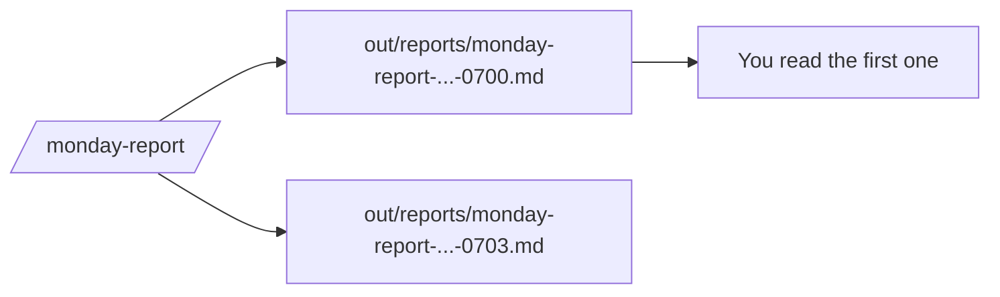
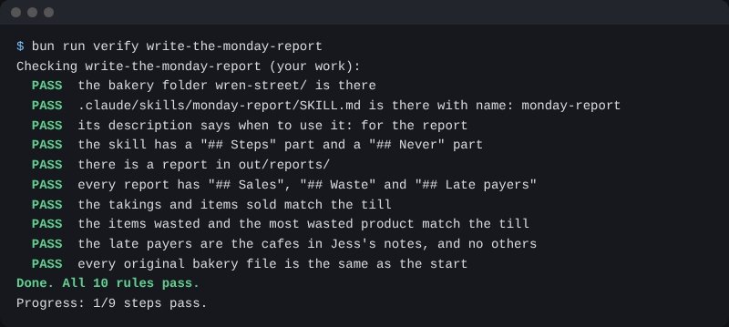

# Keep every report

## The problem

A job that runs alone must not write over its last report. Then nobody can look back. Each run should keep its own file and say when it was made. For example, a report made at 7 and another at 7:03 sit side by side, with the same till numbers in both.



## Watch it done

Before, every run wrote `out/reports/monday-report.md` and the old report was gone. After, each run adds a file and starts with a line that says when it was made.

```text
Made at: 2026-11-13 07:00
```

The folder then holds two files with times in their names.

## Your turn

1. Start `claude` in `wren-street`. Paste this:

```text
Change the monday-report skill. Each run saves a new file named
out/reports/monday-report-YYYY-MM-DD-HHMM.md, with the time from the
date command. Never write over an old report. Start each report
with the line "Made at: YYYY-MM-DD HH:MM".
```

Expect: Claude shows the new Steps: run `date`, save a file with the time in its name. Say yes.

2. Type `/exit`, `claude`, then `/monday-report`. Say yes to each prompt.

Expect: a file in `out/reports/` with a time in its name.

3. Wait a few minutes. Run `/monday-report` again.

Expect: a second file. The first one is still there.

## Do it on your work

Change one of your own report skills the same way. Good looks like this: two runs leave two files, and both start with a time.

## Done when

- Two or more reports start with a Made at line.
- They were made at least a minute apart. A copy does not count.
- Every number in them matches the till.
- No original file has changed.

Ask Claude to check my work for keep-every-report, and not to change anything. It runs:

```bash
bun run verify keep-every-report
```

Expect: `Done. All 8 rules pass.`



## Solution

The after state is in `solution/`: the changed skill and two reports.

## If you get stuck

| What you see                           | Try this                                         |
| -------------------------------------- | ------------------------------------------------ |
| `FAIL  2 or more reports start with`   | The skill wrote over the old file. Ask for a new file name each run. |
| `FAIL  made at least one minute apart` | Run it again a few minutes later. Do not copy a file. |

## Words you will use

- **Run**: one time the skill makes a report.
