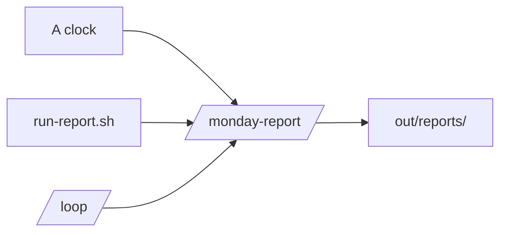
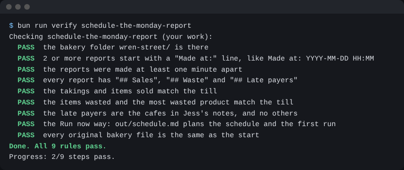

# Schedule the Monday report

## The problem

Jess wants the report waiting for her, with nobody at the keyboard. There are three ways to start Claude alone: a clock, a script, and a loop. For example, a clock can start it at 7 each Tuesday. You read the first runs before you trust any of them.



## Watch it done

A cron line is five numbers that say when a job runs. This one means 7 in the morning on the second day of the week:

```text
0 7 * * 2
```

A script can start Claude with the `-p` flag, which prints the answer and stops. A loop repeats a prompt on an interval.

```text
/loop 1h Run the monday-report skill and tell me if a number changed.
```

## Your turn

1. Start `claude` in `wren-street`. Plan the clock. Paste this:

```text
Make out/schedule.md. Under "## Schedule", write the cron line I would
use, in a code block, in numbers only. Under "## Why I read the first
run", write one sentence on why I read the first report before it runs alone.
```

Expect: a note with a line of five numbers. The desktop app can also run it: click Scheduled, then New task.

2. Make a script. Paste this:

```text
Write run-report.sh in wren-street. One line runs claude with -p and
asks it to run the monday-report skill. Use --permission-mode
acceptEdits and --allowedTools for Skill, mcp__till, Bash(date), Read
and Write. Do not skip any permission check.
```

Expect: a short script. Type `/exit`, then run it:

```bash
bash run-report.sh
```

Expect: a new report appears in `out/reports/`.

3. Start `claude` and paste a loop:

```text
/loop 1h Run the monday-report skill and tell me if a number changed.
```

Expect: Claude says it will repeat each hour. Ask it to save that line in `out/loop.md`, then stop the loop.

## Do it on your work

Do the same for one of your own reports. Good looks like this: a cron note, a script with `-p`, and a loop line.

## Done when

- `out/schedule.md` has a cron line of numbers and says why you read the first run. Or two reports from a task were an hour apart.
- `run-report.sh` runs claude with `-p`, names the skill, and keeps the permission checks.
- `out/loop.md` has a loop line with an interval and the report it repeats.

Ask Claude to check my work for schedule-the-monday-report, and not to change anything. It runs:

```bash
bun run verify schedule-the-monday-report
```

Expect: `Done. All 12 rules pass.`



## Solution

The after state is in `solution/`: the note, the script and the loop note.

## If you get stuck

| What you see                              | Try this                                             |
| ----------------------------------------- | ---------------------------------------------------- |
| `FAIL  it ran on a schedule, or`          | Use numbers in the cron line.                        |
| `FAIL  run-report.sh runs claude with -p` | The line must start with claude and have `-p` in it. |
| `FAIL  out/loop.md has a /loop line`      | Write the interval, like 1h, then what to repeat.    |

## Words you will use

- **Headless**: Claude runs with no chat window, as in `claude -p`.
- **Loop**: a prompt that repeats on an interval while the session is open.
