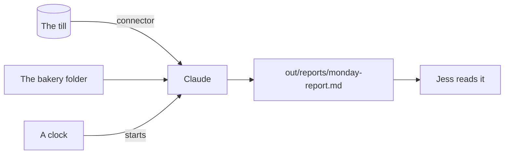

# Connect it and let it run

## The problem

Jess wants the Monday report without asking for it. The numbers live in the till, not in a file Claude can guess at. And a job that runs by itself must be right before you stop watching it.

A solar firm uses Claude to sort permit emails. "About 71% of emails are fully processed without human intervention" ([Freedom Forever](https://claude.com/customers/freedom-forever)).

In this part you meet the terminal, connect the till to Claude, write the report as a skill, and set it to run on its own.



## The steps

| Step | Minutes | What you make | What the check reads |
|---|---|---|---|
| open-the-terminal | 15 | `out/terminal.md` | The version is new enough; the mode is named |
| connect-the-till | 20 | The till connector and `out/till-today.md` | The connector is there; the total matches the till |
| write-the-monday-report | 25 | A `monday-report` skill and the report | Sales, Waste, Late payers; every number matches the till |
| schedule-the-monday-report | 15 | Two reports from the skill | Made by a scheduled task, or by Run now plus `out/schedule.md` |

The free plan and some work laptops cannot run scheduled tasks. The last step has a second way to pass for them.

## Walkthrough

TODO(part session): one paragraph per step and its exact Expect line.

```bash
bun run verify part connect-and-schedule
```

Expect: TODO(part session)
